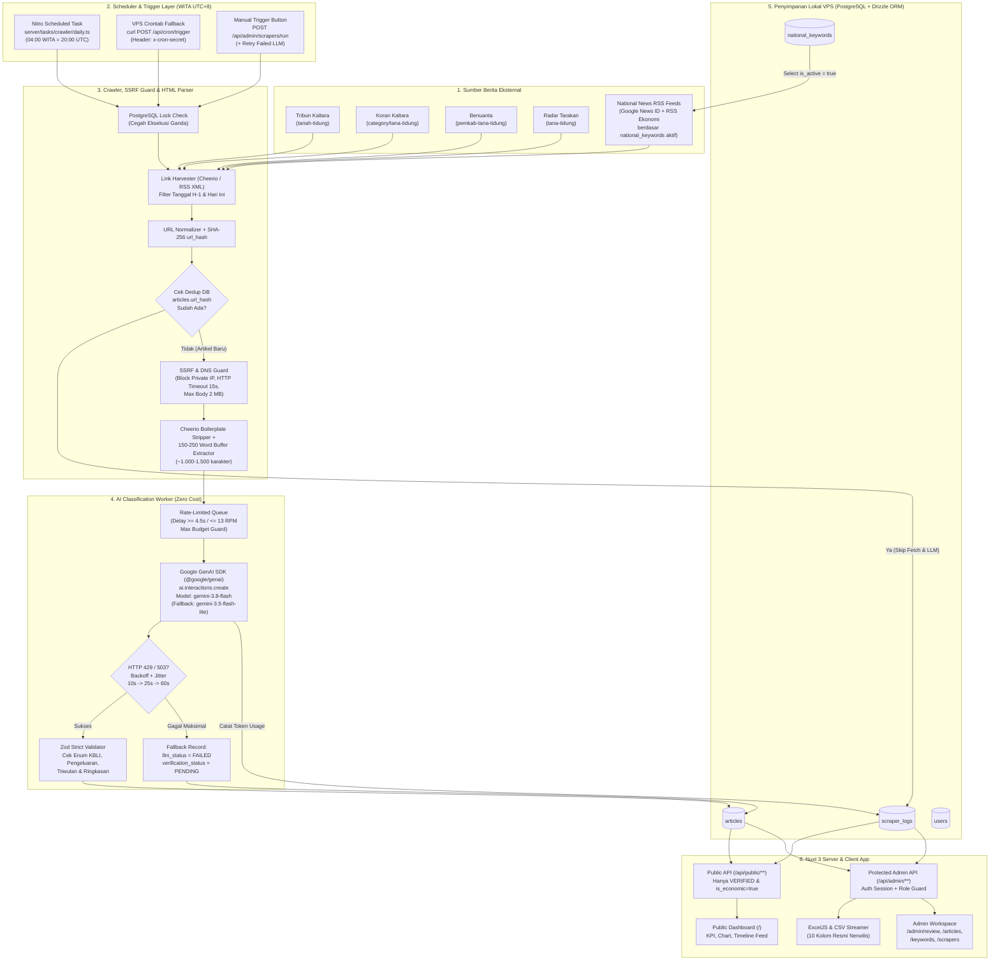

# System & Pipeline Architecture — SIPENA KTT

**Versi Dokumen:** 1.0.0 (Single Source of Truth)  
**Target Stack:** Nuxt 3 Full-Stack Monolith (Nitro Engine, Vue 3 `<script setup>`, TypeScript), PostgreSQL 16 (VPS Ubuntu 24.04), Drizzle ORM, Cheerio, Google GenAI SDK (`@google/genai`), ExcelJS (`exceljs`).

---

## 1. Arsitektur Data End-to-End

SIPENA KTT dibangun sebagai **monolit modular di atas Nuxt 3 + Nitro**. Satu proses aplikasi Node.js melayani antarmuka SSR/SPA Vue 3, REST API endpoint (`/api/**`), mesin *scraper* dan klasifikasi AI latar belakang, serta pengekspor berkas Excel. Pendekatan ini meminimalkan kompleksitas deployment di VPS Ubuntu 24.04 tanpa perlu mengelola Redis atau message broker terpisah untuk skala volume berita kabupaten (~20–80 artikel kandidat per hari).

### 1.1 Diagram Arsitektur Data End-to-End



---

## 2. Pipeline Scraper & Penjadwalan Cron (Nitro Tasks vs Crontab VPS)

### 2.1 Struktur Pipeline Eksekusi Harian
Setiap siklus eksekusi (`runDailyPipeline`) mengikuti 6 fase berurutan:
1. **Acquire Execution Lock:** Memeriksa `scraper_logs` apakah ada record dengan `status = 'RUNNING'` dalam 30 menit terakhir (atau memakai `pg_try_advisory_lock(982451)` di PostgreSQL). Jika masih berjalan, permintaan baru ditolak bersih dengan status `409 Conflict` untuk mencegah pemborosan kuota LLM. Inisialisasi baris log baru di `scraper_logs` (`status = 'RUNNING'`).
2. **Fetch Active Keywords:** Mengambil daftar `national_keywords` di mana `is_active = true`.
3. **Harvest Index Pages (Phase A — Link Discovery):**
   - Mengunduh halaman kategori dari **4 portal regional**. Untuk setiap portal, modul *adapter* mengekstrak URL artikel, judul awal, dan petunjuk tanggal terbit. Artikel di luar jendela toleransi H-3 hari (fokus utama H-1 & hari berjalan, toleransi H-3 untuk antisipasi berita terlambat terindeks) disaring lebih awal agar tidak mengambil arsip lama berulang kali.
   - Untuk setiap *keyword* nasional aktif, melakukan *fetch* umpan pencarian Google News RSS (`https://news.google.com/rss/search?q=<keyword>+when:2d&hl=id&gl=ID&ceid=ID:id`) dan mem-parsing `<item>` via Cheerio XML mode (`xmlMode: true`), lalu menyelesaikan URL kanonikal apabila diperlukan.
4. **URL Deduplication Check (Phase B — Pre-Fetch Filter):**
   - Melakukan normalisasi tiap kandidat URL -> hash `SHA-256` (`url_hash`).
   - Melakukan 1 kueri batch PostgreSQL (`SELECT url_hash FROM articles WHERE url_hash IN (...)`) untuk menyaring URL yang sudah pernah diproses sebelumnya. Hanya URL yang benar-benar baru (*unseen*) yang lanjut ke tahap pengunduhan isi halaman.
5. **HTML Extraction dengan Word Threshold 150–250 Kata (Phase C):**
   - Setiap URL baru melewati `safeFetchHtml(url)` (validasi SSRF, batas 2 MB, timeout 15 detik).
   - Cheerio membuang seluruh elemen pengganggu (`script`, `style`, `noscript`, `iframe`, `nav`, `aside`, `footer`, `.baca-juga`, `.iklan`, `.related-posts`, `.tags`, `.share-buttons`).
   - Mengekstrak metadata tanggal terbit (`meta[property="article:published_time"]`, `time[datetime]`, JSON-LD `datePublished`, atau parser teks tanggal bahasa Indonesia seperti *"11 November 2026, 14:30 WITA"*) lalu mengonversinya ke UTC/WITA (`Asia/Makassar`).
   - Menjalankan algoritma *Word Threshold Extractor*:
     ```ts
     // Pseudocode inti extractor 150–250 kata
     const MIN_WORDS = 150;
     const MAX_WORDS = 250;
     const MAX_CHARS = 1500;
     ```
     Iterasi setiap elemen `<p>` di dalam kontainer artikel utama dari atas ke bawah. Paragraf yang hanya berisi *dateline* redundan (mis. `"REPUBLIKA.CO.ID, TANJUNG SELOR --"` saja tanpa isi), *caption* foto, atau ajakan *"Baca juga:"* dibuang lewat filter regex. Teks bersih ditambahkan paragraf demi paragraf hingga total kata `>= 150`. Jika penambahan paragraf berikutnya melampaui `250` kata atau `1.500` karakter, potongan dipangkas pada batas kalimat/kata paling dekat tidak lebih dari `250` kata.
6. **AI Classification & Persistensi (Phase D):**
   - Mengirim payload ringkas (Judul, Sumber, Tanggal Rilis WITA, Teks 150–250 Kata) ke Gemini Worker secara berurutan dengan *rate pacing*.
   - Menulis hasil ke tabel `articles` (memakai `ON CONFLICT (url_hash) DO NOTHING` sebagai pengaman terakhir konkurensi).
   - Memperbarui `scraper_logs` (`status = 'SUCCESS' | 'PARTIAL' | 'FAILED'`, seluruh counter artikel, jumlah token LLM, dan `duration_ms`).

### 2.2 Perbandingan & Kombinasi Nitro Scheduled Tasks vs Crontab VPS
Pada environment deployment **VPS Ubuntu 24.04 (PM2 running Nitro preset `node-server`)**, Nitro menyediakan fitur bawaan `scheduledTasks`:

| Aspek | Nitro Scheduled Tasks (`server/tasks/`) | Crontab VPS Ubuntu (`cron` + `curl`) | Keputusan Arsitektur SIPENA KTT |
|---|---|---|---|
| **Integrasi Kode** | Native TypeScript (`defineTask`), langsung akses Drizzle DB & services tanpa HTTP overhead | Memerlukan endpoint HTTP `POST /api/cron/trigger` + header secret | **Utama: Nitro Scheduled Tasks** (`preset: 'node-server'` dengan 1 instance worker PM2) |
| **Multi-Worker / Restart** | Jika memakai PM2 `cluster` > 1 instance, cron internal Nitro jalan di setiap worker | Berjalan terpusat di level OS tepat 1 kali | Jalankan PM2 dalam `fork` mode (1 proses cukup untuk skala KTT) **DAN** sediakan endpoint `/api/cron/trigger` terproteksi + advisory lock DB |
| **Zona Waktu Eksekusi** | Cron server Linux mengikuti `TZ` sistem / UTC | Mendukung `CRON_TZ=Asia/Makassar` langsung di `/etc/crontab` | Jadwal Nitro memakai ekspresi UTC yang setara: `'0 20 * * *'` (= `04:00 WITA / UTC+8`), atau OS Cron jika user memilih menonaktifkan scheduler internal via ENV `ENABLE_NITRO_CRON=false` |

Konfigurasi `nuxt.config.ts` yang ditargetkan:
```ts
nitro: {
  experimental: {
    tasks: true,
  },
  scheduledTasks: {
    // 20:00 UTC = 04:00 WITA (Asia/Makassar) setiap dini hari
    '0 20 * * *': ['crawler:daily'],
    // 22:30 UTC = 06:30 WITA: sapuan ulang otomatis artikel llm_status = 'FAILED'
    '30 22 * * *': ['crawler:retry-llm'],
  },
}
```
> **Catatan Keamanan Operasional:** Variabel lingkungan `ENABLE_NITRO_CRON=true` menjaga agar pada mode cluster/pengujian lokal task subuh dapat dikendalikan tanpa mengubah kode. Jika admin memilih mengandalkan `crontab` OS Ubuntu (`0 4 * * * curl -fsS -X POST https://sipena.tanatidung.go.id/api/cron/trigger -H "x-cron-secret: $CRON_SECRET"`), set `ENABLE_NITRO_CRON=false`. Keduanya memanggil *service* yang sama (`runDailyScrapeJob`) yang dijaga oleh *PostgreSQL advisory lock*.

---

## 3. Strategi Token Optimization & Error Handling

### 3.1 Token Optimization (Zero-Cost Operation)
Dengan memanfaatkan Google AI Studio **Free Tier**, batas utama bukanlah biaya melainkan **RPM (Requests Per Minute)**, **TPM (Tokens Per Minute)**, dan **RPD (Requests Per Day)**. Strategi optimasi disusun berlapis:

1. **Pre-LLM URL Deduplication:** URL yang telah tersimpan (baik `VERIFIED`, `PENDING`, maupun `IGNORED` non-ekonomi) langsung di-*skip* pada Phase B sehingga **0 token** dihabiskan untuk berita berulang.
2. **Title-Level Hard Noise Filter (Deterministic Pre-Screen):** Sebelum melakukan *HTTP fetch* isi berita penuh atau memanggil LLM, judul yang mutlak berada di kategori non-ekonomi murni (mis. jadwal sholat, prakiraan cuaca harian rutin tanpa bencana, hasil pertandingan sepak bola, berita selebritas/hiburan nasional) apabila bukan berasal dari portal KTT dapat langsung disaring atau ditandai `IGNORED` ringan—namun untuk 4 portal lokal Tana Tidung tetap dikirim ke AI demi menghindari *false negative* berita berdampak pada sektor `R` (Hiburan/Pariwisata) atau `A` (Cuaca ekstrem yang memengaruhi panen/nelayan).
3. **150–250 Word Cap (~1.000–1.500 karakter):** Memangkas artikel berita rata-rata 700–1.200 kata + markup HTML menjadi maksimal ~250 kata teks polos. Reduksi payload ini menurunkan input token per artikel dari ~3.500–8.000 token menjadi **~320–420 token isi artikel** (total dengan *system instruction* hanya ~700–850 token/artikel).
4. **Stateless Calls (`store: false`):** Menggunakan parameter `store: false` pada `ai.interactions.create(...)` karena setiap klasifikasi berita bersifat independen 1-turn (*stateless*), sehingga tidak menyimpan riwayat percakapan di server API.
5. **Compact Enum Keys di JSON Output:** Skema JSON meminta kode pendek (`"A"`..`"U"`, `"INCREASE_NTB"`, `"PK_RT"`, dst.) sehingga token output tetap kecil (~90–150 output tokens) sekaligus mencegah kesalahan ejaan label panjang.
6. **Per-Run Budget Guard:** Env `SCRAPER_MAX_LLM_CALLS_PER_RUN` (default `150`) memastikan satu sesi *scraping* tidak menguras habis kuota harian API Key jika sebuah portal tiba-tiba mempublikasikan ratusan artikel arsip lama.

### 3.2 Penanganan Error LLM, HTTP 429, dan Mekanisme Fallback
Setiap panggilan ke `@google/genai` dibungkus dalam *resilient worker client* dengan logika berikut:

| Skenario Kegagalan | Respons Sistem & Retry | Fallback Status di Database |
|---|---|---|
| **HTTP `429 RESOURCE_EXHAUSTED` (Rate Limit RPM)** | *Exponential backoff with jitter*: Percobaan ke-1 tunggu `10s + jitter(0..3s)`, ke-2 `25s + jitter(0..5s)`, ke-3 `60s + jitter(0..8s)`. | Jika seluruh retry gagal pada `gemini-3.8-flash`, coba 1x model cadangan `gemini-3.5-flash-lite`. Jika tetap `429`, simpan artikel dengan `llm_status = 'FAILED'`, `verification_status = 'PENDING'`, `llm_error = 'RATE_LIMIT_EXCEEDED'`. |
| **HTTP `503` / Network Timeout (> 30s)** | Retry hingga 2 kali dengan jeda `5s`, `15s`. | Simpan artikel dengan teks 150–250 kata tetap utuh di PostgreSQL, `llm_status = 'FAILED'`, `verification_status = 'PENDING'`. Tidak ada artikel yang hilang! |
| **JSON Output Tidak Valid / Gagal Validasi Zod** | Retry 1 kali dengan pengingat skema. | Simpan `llm_status = 'FAILED'`, catat payload error di `llm_error`, masuk antrean `Pending` admin agar dapat diedit manual atau di-retry. |
| **Portal HTML Gagal Diunduh (`403` Cloudflare / `404` / `5xx` / Timeout)** | Lanjut ke URL/portal berikutnya (isolasi kegagalan per portal/URL — satu portal error tidak membatalkan portal lain). | Catat error portal pada `scraper_logs.error_summary` JSONB. Jika sebagian portal sukses, status log menjadi `'PARTIAL'`. |
| **Kuota Harian API Habis (Multiple 429 RPD)** | *Circuit breaker* aktif setelah 5 kali kegagalan 429 berturut-turut dalam satu batch: hentikan panggilan LLM untuk sisa antrean, namun **tetap simpan artikel ter-crawl** dengan `llm_status = 'FAILED'` (`llm_error = 'CIRCUIT_BREAKER_QUOTA'`) agar di-retry pukul 06:30 WITA atau hari berikutnya. | Status `scraper_logs` dicatat `'PARTIAL'`, tersedia tombol **Retry Failed LLM** di `/admin/scrapers`. |

---

## 4. Arsitektur Keamanan & Kontrol Akses

1. **Pemisahan Rute Publik vs Terproteksi:**
   - Middleware Nitro (`server/middleware/01.security-headers.ts`) menambahkan header keamanan HTTP pada semua respons.
   - Middleware auth admin pada handler rute `/api/admin/**` dan route middleware client (`app/middleware/admin-auth.ts`) memastikan sesi terenkripsi (`nuxt-auth-utils`) valid dan `user.tokenVersion` masih cocok dengan database serta `isActive = true`.
2. **Validasi Batas Sistem & Sanitasi:**
   - Setiap endpoint `POST`/`PATCH`/`GET` query memakai `readValidatedBody` / `getValidatedQuery` berbasis Zod schema dari `shared/schemas/`.
   - Helper `safeFetchHtml` memeriksa skema URL, menolak kredensial di URL, melakukan resolusi DNS (`dns.lookup(..., { all: true })`), memblokir seluruh IP privat/reserved IPv4 & IPv6 sebelum koneksi dibuka, dan menonaktifkan pengalihan otomatis lintas host tidak aman.
   - Generator `.csv` menetralkan sel yang diawali karakter berbahaya (`=`, `+`, `-`, `@`, `\t`, `\r`) dengan awalan apostrof atau pembungkusan aman untuk mencegah *CSV Formula Injection* saat dibuka di Excel.

---

## 5. Struktur Folder Proyek Nuxt 3 Monolitik

Struktur proyek mengikuti standar resmi Nuxt 3 modern (`app/` source layout atau root Nuxt 3 dengan pemisahan bersih `shared/` untuk kontrak tipe/Zod dan `server/` untuk Nitro):

```text
sipena-ktt/
├── .env.example                     # Template env (DATABASE_URL, GEMINI_API_KEY, NUXT_SESSION_PASSWORD, CRON_SECRET)
├── nuxt.config.ts                   # Konfigurasi modul (@nuxt/ui, @nuxt/icon, nuxt-auth-utils), Nitro tasks, runtimeConfig
├── drizzle.config.ts                # Konfigurasi migrasi Drizzle Kit ke PostgreSQL lokal
├── package.json
├── tsconfig.json
│
├── docs/                            # Single Source of Truth (PRD, Architecture, Schema, Design, LLM Prompt Spec)
│   ├── prd.md
│   ├── architecture.md
│   ├── schema.md
│   ├── design.md
│   └── llm-prompt-spec.md
│
├── shared/                          # Kode isomorfik (dipakai bersama oleh Server Nitro & Client Vue)
│   ├── enums/
│   │   └── pdrb.ts                  # Enums A-U, KbliImpact, ExpenditureComponent, ExpenditureImpact, VerificationStatus + Label Maps
│   ├── schemas/
│   │   ├── article.schema.ts        # Zod schema filter query, manual insert, update review, batch action
│   │   ├── keyword.schema.ts        # Zod schema CRUD master keyword nasional
│   │   ├── llm-output.schema.ts     # Zod schema & JSON Schema Output Terstruktur Gemini Flash
│   │   └── auth.schema.ts           # Zod schema login
│   └── utils/
│       └── period.ts                # Helper konversi tanggal WITA -> Triwulan (I-IV) & format 'dd/mm/yyyy'
│
├── app/                             # Frontend Nuxt 3 (Pages, Components, Layouts, Composables)
│   ├── app.config.ts                # Token warna Nuxt UI v3 (primary: 'teal', neutral: 'slate') & varian komponen
│   ├── assets/css/main.css          # @import "tailwindcss"; @import "@nuxt/ui"; + CSS variables @theme
│   ├── layouts/
│   │   ├── default.vue              # Layout Publik (Top Navbar bersih + Footer institusional)
│   │   └── admin.vue                # Layout Admin Workspace (Sidebar navigasi + Header user + Badge Pending count)
│   ├── middleware/
│   │   └── auth.ts                  # Route guard halaman /admin/** -> redirect ke /login
│   ├── composables/
│   │   ├── usePdrbLabels.ts         # Mapping label, warna badge, & ikon untuk KBLI/Pengeluaran/Dampak
│   │   └── useExcelExport.ts        # Trigger download file .xlsx / .csv dengan filter aktif
│   ├── components/
│   │   ├── public/
│   │   │   ├── KpiSnapshotGrid.vue  # 4 kartu metrik triwulan berjalan
│   │   │   ├── SectorDistributionCharts.vue # Grafik proporsi KBLI & Pengeluaran
│   │   │   ├── PublicFilterBar.vue  # Sticky filter bar (Periode, KBLI, Pengeluaran, Search)
│   │   │   └── PhenomenonFeedCard.vue # Kartu berita fenomena read-only
│   │   └── admin/
│   │       ├── ReviewSlideover.vue  # Drawer kanan edit cepat + tampilan teks 200 kata + link sumber
│   │       ├── ManualArticleModal.vue # Modal tambah artikel manual di Bank Data
│   │       ├── KeywordFormModal.vue # Modal tambah/ubah master keyword nasional
│   │       └── ScraperLogTable.vue  # Tabel log crawling & pemakaian token LLM
│   └── pages/
│       ├── index.vue                # Public View (/)
│       ├── login.vue                # Admin Login (/login)
│       └── admin/
│           ├── review.vue           # Verifikasi Harian Cepat (/admin/review)
│           ├── articles.vue         # Bank Data Arsip & Ekspor Excel (/admin/articles)
│           ├── keywords.vue         # Master Keyword Nasional (/admin/keywords)
│           └── scrapers.vue         # Monitor Crawler, Trigger Manual & Token Usage (/admin/scrapers)
│
├── server/                          # Backend Nitro Engine
│   ├── db/
│   │   ├── index.ts                 # Inisialisasi Pool pg + drizzle(pool, { schema })
│   │   ├── schema.ts                # Definisi tabel & relasi Drizzle ORM (sesuai docs/schema.md)
│   │   ├── seed.ts                  # Seed admin awal & 5 master keyword default Tana Tidung
│   │   └── migrations/              # Output SQL terversi dari `drizzle-kit generate`
│   ├── middleware/
│   │   ├── 01-security.ts           # Security headers & rate limit ringan
│   │   └── 02-admin-auth.ts         # Verifikasi sesi & role admin untuk /api/admin/**
│   ├── utils/
│   │   ├── ssrf.ts                  # Validator URL & DNS IP blocklist sebelum fetch
│   │   ├── password.ts              # Argon2/Scrypt password hashing & verification
│   │   └── url-hash.ts              # Normalisasi URL + SHA-256 hashing
│   ├── services/
│   │   ├── scraper/
│   │   │   ├── portals.ts           # Konfigurasi & Cheerio adapter 4 portal regional KTT
│   │   │   ├── national.ts          # Harvester Google News RSS & feed nasional berdasar keywords
│   │   │   ├── extractor.ts         # Pembersih HTML + Word Threshold Extractor (150-250 kata) + parser tanggal WITA
│   │   │   └── pipeline.ts          # Orkestrator end-to-end (Advisory Lock, Dedup, Parse, Queue LLM, Log)
│   │   ├── llm/
│   │   │   ├── gemini-client.ts     # @google/genai client, rate limiter, backoff 429, fallback model
│   │   │   └── classifier.ts        # Builder prompt + schema validation output fenomena ekonomi
│   │   └── export/
│   │       ├── excel.ts             # Generator .xlsx (ExcelJS) tepat 10 kolom resmi Nerwilis
│   │       └── csv.ts               # Generator .csv UTF-8 BOM + proteksi formula injection
│   ├── tasks/
│   │   └── crawler/
│   │       ├── daily.ts             # Nitro Task `crawler:daily` (04:00 WITA)
│   │       └── retry-llm.ts         # Nitro Task `crawler:retry-llm` (06:30 WITA)
│   └── api/
│       ├── health.get.ts            # Healthcheck DB & uptime untuk Nginx/monitoring
│       ├── cron/
│       │   └── trigger.post.ts      # Fallback crontab eksternal (validasi x-cron-secret)
│       ├── auth/
│       │   ├── login.post.ts        # Autentikasi admin + rate limiting
│       │   ├── logout.post.ts       # Hapus session cookie
│       │   └── me.get.ts            # Profil admin aktif
│       ├── public/
│       │   ├── overview.get.ts      # KPI snapshot & agregasi grafik triwulanan (hanya VERIFIED)
│       │   └── articles.get.ts      # Feed paginasi & filter berita publik (hanya VERIFIED)
│       └── admin/
│           ├── articles/
│           │   ├── index.get.ts     # Query bank data / tab review (Pending/Verified/Ignored)
│           │   ├── index.post.ts    # Tambah berita manual
│           │   ├── [id].patch.ts    # Edit klasifikasi / verifikasi 1 artikel
│           │   ├── [id].delete.ts   # Hapus permanen artikel (khusus spam/kesalahan fatal)
│           │   ├── batch.post.ts    # Batch action: Verifikasi / Abaikan massal
│           │   └── export.get.ts    # Stream download .xlsx / .csv (10 kolom resmi)
│           ├── keywords/
│           │   ├── index.get.ts     # Daftar master keyword + statistik hit jumlah artikel
│           │   ├── index.post.ts    # Tambah keyword baru
│           │   ├── [id].patch.ts    # Edit keyword atau toggle is_active
│           │   └── [id].delete.ts   # Hapus keyword (articles.keyword_id menjadi NULL)
│           └── scrapers/
│               ├── logs.get.ts      # Riwayat log eksekusi crawler & statistik penggunaan token LLM
│               ├── run.post.ts      # Trigger manual full scraping
│               └── retry-llm.post.ts # Jalankan ulang klasifikasi artikel `llm_status = 'FAILED'`
│
└── tests/                           # Vitest unit & integration tests
    ├── extractor.test.ts            # Uji word threshold 150-250 kata & boilerplate stripping
    ├── period.test.ts               # Uji penentuan Triwulan I-IV di zona waktu WITA
    ├── llm-schema.test.ts           # Uji validasi JSON Schema & aturan non-ekonomi
    └── export-excel.test.ts         # Uji urutan tepat 10 kolom ExcelJS
```

---

## 6. Kontrak Antarmuka API Utama (Ringkasan Teknis)

| Endpoint | Method | Akses | Parameter / Payload Ringkas | Deskripsi Respons |
|---|---|---|---|---|
| `/api/public/overview` | `GET` | Publik | `?year=2026&quarter=4` | KPI total terverifikasi, sektor & pengeluaran dominan, agregasi grafik distribusi KBLI & Pengeluaran |
| `/api/public/articles` | `GET` | Publik | `?year=&quarter=&kbli=&expenditure=&q=&page=1&limit=20` | Daftar artikel `VERIFIED` terpaginasi, diurutkan `published_at DESC` |
| `/api/admin/articles` | `GET` | Admin | `?status=PENDING&llmStatus=&kbli=&expenditure=&portal=&from=&to=&q=&page=1&limit=25` | Daftar lengkap untuk meja review harian & bank data + ringkasan hitungan tab (`pendingCount`, `verifiedCount`, `ignoredCount`) |
| `/api/admin/articles/[id]` | `PATCH` | Admin | JSON parsial klasifikasi + `verificationStatus` | Mengubah klasifikasi/ringkasan/periode atau status verifikasi; otomatis mengisi `verifiedBy` & `verifiedAt` bila status menjadi `VERIFIED` |
| `/api/admin/articles/batch` | `POST` | Admin | `{ ids: string[], action: 'VERIFY' \| 'IGNORE' }` | Memvalidasi kelengkapan klasifikasi tiap item saat `VERIFY`, mengembalikan jumlah sukses & daftar item yang belum lengkap |
| `/api/admin/articles/export` | `GET` | Admin | `?format=xlsx\|csv&year=&quarter=&kbli=&expenditure=&status=&from=&to=&q=` | Mengirim binary `.xlsx` (`application/vnd.openxmlformats-officedocument.spreadsheetml.sheet`) atau `.csv` dengan 10 kolom baku |
| `/api/admin/scrapers/run` | `POST` | Admin | `{ mode: 'ALL' \| 'REGIONAL_ONLY' \| 'NATIONAL_ONLY' }` | Memicu pipeline scraper di background/async dan segera mengembalikan `{ logId, status: 'RUNNING' }` (`202 Accepted`) untuk dipantau UI |

---

## 7. Strategi Deployment VPS Ubuntu 24.04

1. **Build Produksi:** `npm run build` menghasilkan bundel mandiri Nitro di `.output/`.
2. **Process Manager (PM2):**
   - Menjalankan `node .output/server/index.mjs` dalam `exec_mode: 'fork'`, `instances: 1`, `max_memory_restart: '900M'`, dan `NODE_ENV=production`.
   - Mode `fork` tunggal menjamin Nitro `scheduledTasks` berjalan tepat satu kali per jadwal tanpa duplikasi antar proses.
3. **Database Lokal:** PostgreSQL 16 terikat ke `127.0.0.1:5432` (tidak dibuka ke publik firewall UFW) dengan pool koneksi `max: 10` di Nitro `pg.Pool`. Migrasi skema dijalankan eksplisit saat deploy lewat `npx drizzle-kit migrate`.
4. **Nginx Reverse Proxy:** Meneruskan port `80/443` (HTTPS Let's Encrypt) ke `127.0.0.1:3000` dengan timeout khusus `proxy_read_timeout 120s` untuk endpoint ekspor Excel skala besar.

