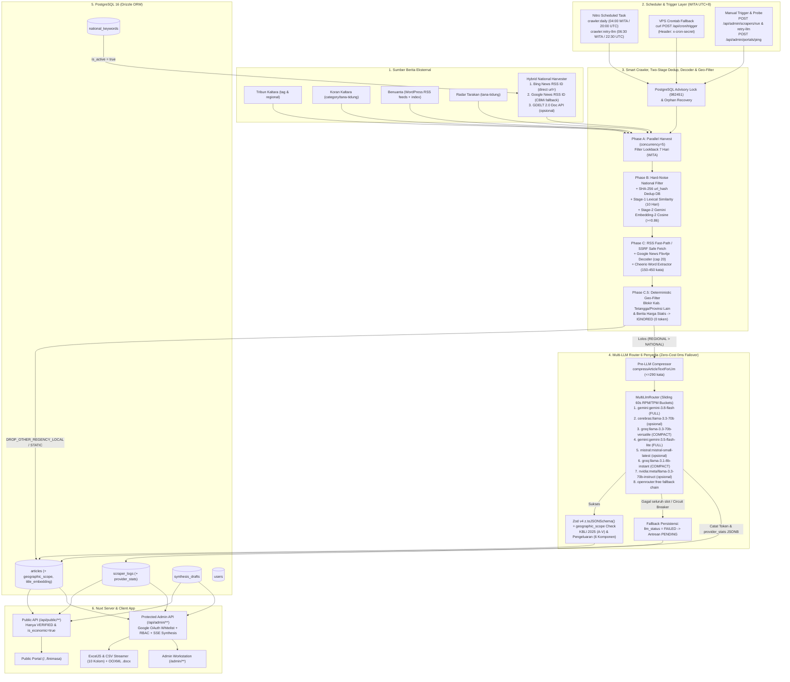

# System & Pipeline Architecture — SIPENA KTT

**Versi Dokumen:** 2.1.0 (Single Source of Truth — 6-Provider Multi-LLM Router, Semantic Dedup, Zod v4 & KBLI 2025)  
**Target Stack:** Nuxt 3/4 Compat (`future.compatibilityVersion: 4`, Nitro Engine, Vue 3 `<script setup>`, TypeScript), PostgreSQL 16 (VPS Ubuntu 24.04), Drizzle ORM, Zod v4 (`z.toJSONSchema`), Cheerio, `@google/genai` + Cerebras + Groq + Mistral + NVIDIA NIM + OpenRouter (`MultiLlmRouter`), ExcelJS (`exceljs`).

---

## 1. Arsitektur Data End-to-End

SIPENA KTT dibangun sebagai **monolit modular di atas Nuxt + Nitro**. Satu proses aplikasi Node.js melayani antarmuka SSR/SPA Vue 3, REST/SSE API endpoint (`/api/**`), mesin *smart scraper*, orkestrator klasifikasi AI 6-penyedia (`MultiLlmRouter`) beserta embedding semantik, serta pengekspor berkas Excel `.xlsx`, `.csv`, dan OOXML `.docx`. Pendekatan ini menjaga kompleksitas deployment di VPS Ubuntu 24.04 tetap minimal tanpa memerlukan Redis atau broker terpisah.

### 1.1 Diagram Arsitektur Data End-to-End



---

## 2. Pipeline Scraper Cerdas & Penjadwalan Cron

### 2.1 Enam Fase Eksekusi Harian (`executeLockedScrapePipeline`)
1. **Acquire Advisory Lock & Recovery:** Memakai `pg_try_advisory_lock(982451)` pada koneksi pool PostgreSQL + `recoverOrphanedRunningLogsInternal` untuk memulihkan log `RUNNING` yatim akibat restart server. Permintaan tumpang tindih ditolak bersih dengan HTTP `409 Conflict`.
2. **Phase A — Parallel Link Discovery:**
   - **Regional Portals (`portals.ts`):** Memanen **4 portal regional** secara paralel (`concurrency = 5`, lookback 7 hari WITA). Portal WordPress (`benuanta.co.id`) mengutamakan jalur cepat **`feedUrls` RSS XML** (`content:encoded` terstruktur) sebelum fallback ke HTML; kontainer sidebar/widget terpopuler dibuang dan URL subkanal kabupaten tetangga (`/nunukan/`, `/tarakan/`, dst. tanpa jangkar KTT) langsung ditolak. Admin juga dapat menguji konektivitas & deteksi *soft-block* masing-masing portal secara langsung via `POST /api/admin/portals/ping`.
   - **Hybrid National Harvester (`national.ts`):** Untuk setiap kata kunci aktif pada `national_keywords`, menjalankan **`Promise.allSettled` ke Bing News RSS (`bing.com/news/search?format=rss`), Google News RSS (`news.google.com/rss/search`), serta GDELT 2.0 Doc API opsional (`ENABLE_GDELT_FEED`, `GDELT_DOC_API_BASE`)**. Bing diutamakan karena parameter `url=` pada tautan `apiclick.aspx` berisi URL penerbit asli secara langsung; jika berita yang sama muncul di Google wrapper `CBMi...`, `upsertCandidate` menggantinya dengan URL penerbit langsung.
3. **Phase B — Pre-Fetch Noise Filter, Hash Dedup & Two-Stage Title Deduplication:**
   - `title-filter.ts` menyaring *hard noise* khusus sumber nasional (jadwal sholat, skor bola, tarif PLN/BBM stagnan, grafik historis). Portal regional tidak pernah di-drop pada tahap judul ini.
   - Normalisasi URL + `SHA-256 url_hash` dicek batch ke tabel `articles`.
   - `dedup.ts` menjalankan **Stage-1 lexical deduplication** (`computeTitleSimilarity`, kombinasi Jaccard + Containment + *numeric guard* agar angka Rp 2.500 vs Rp 2.980 tidak tergabung keliru) **dan Stage-2 optional semantic embedding deduplication** via `gemini-embedding-2` (cosine similarity $\ge 0.86$ pada `articles.title_embedding` 10 hari terakhir bila `GEMINI_API_KEY` tersedia, dengan proteksi *numeric guard*). Saat bentrok antar sumber, urutan prioritas pemenang selalu `REGIONAL (300) > NATIONAL langsung (200) > Google News wrapper (100)`.
4. **Phase C — SSRF Safe Fetch, Fbv4je Decoder & Word Extractor:**
   - Kandidat RSS WordPress berteks penuh $\ge 30$ kata melewati jalur cepat tanpa *re-fetch* HTML.
   - Kandidat HTML diambil via `safeFetchText` (proteksi DNS/IP privat, HTTP timeout `7s`, batas 2 MB). Jika URL masih mendarat di wrapper JS `news.google.com`, **`google-news-decoder.ts`** mengekstrak `data-n-a-id`/`ts`/`sg` dan memanggil endpoint `batchexecute?rpcids=Fbv4je` (dibatasi `cap = 20/run`, jeda `250ms`, validasi SSRF pada endpoint dan target URL). Jika gagal atau terblokir paywall, `buildNationalFallbackSnippet` membuat cuplikan metadata netral tanpa menyisipkan lokus KTT palsu.
   - `extractor.ts` mengekstrak teks bersih lewat urutan **JSON-LD `NewsArticle`/`Article` → selector artikel spesifik → heuristik paragraf terbersih**, mem-parsing tanggal WITA, dan menyimpan cuplikan bersih hingga ambang 150–450 kata.
5. **Phase C.5 — Deterministic Geographic Relevance Gate (`geo-filter.ts`):**
   - Menilai kombinasi judul, cuplikan teks, URL, dan `sourceType` untuk memblokir berita lokal eksklusif kabupaten/provinsi lain (`Nunukan/Krayan/Sebatik`, `Tarakan`, `Bulungan/Tanjung Selor`, `Malinau`, `Riau/Jambi/...`) maupun berita harga statis tanpa keterkaitan ke Kab. Tana Tidung/Kaltara makro. Artikel yang tertahan dicatat langsung sebagai `verification_status = 'IGNORED'`, `llm_model = 'geo-filter' | 'title-geo-filter'`, **menghabiskan 0 token LLM** sambil mengunci `url_hash` di database.
   - Sisa antrean diurutkan berdasarkan prioritas (`REGIONAL > NATIONAL langsung > fallback`) dan dipotong pada batas `SCRAPER_MAX_ARTICLES_PER_RUN` (default `35`).
6. **Phase D — Multi-LLM Classification Router (`router.ts`) + SSE Synthesis:**
   - Teks dikompres oleh `compressArticleTextForLlm` (`<= 290` kata / `<= 1.900` karakter) dan diarahkan oleh **`MultiLlmRouter`** (timeout keras `3 menit`, circuit breaker `5x` kegagalan 429 berturut-turut di seluruh slot) memakai **`LLM_CLASSIFICATION_JSON_SCHEMA`** yang dihasilkan dari `z.toJSONSchema()` (Zod v4). Seluruh telemetri per slot direkam dalam `scraper_logs.provider_stats`. Pada modul `/admin/synthesis`, `POST /api/admin/synthesis/generate` mendukung streaming **`text/event-stream` (SSE)** (`meta` → `chunk` → `done`) secara *real-time*.

---

## 3. Orkestrasi `MultiLlmRouter`, Optimasi Token & Failover 0ms

`server/services/llm/router.ts` mengelola rantai prioritas **6 penyedia LLM gratis** berikut (slot opsional otomatis aktif bila API key tersedia):
1. **`gemini:gemini-3.8-flash`** (Google AI Studio — `5 RPM / 250k TPM`, menerima `SIPENA_SYSTEM_INSTRUCTION_FULL`)
2. **`cerebras:llama-3.3-70b`** (Cerebras Cloud opsional — `28 RPM / 60k TPM`, `14.400 RPD`, menerima `SIPENA_SYSTEM_INSTRUCTION_COMPACT`)
3. **`groq:llama-3.3-70b-versatile`** (Groq Cloud — `28 RPM / 11k TPM`, `1.000 RPD`, menerima `SIPENA_SYSTEM_INSTRUCTION_COMPACT`)
4. **`gemini:gemini-3.5-flash-lite`** (Google AI Studio — `10 RPM / 250k TPM`, menerima `FULL`)
5. **`mistral:mistral-small-latest`** (Mistral Experiment opsional — `25 RPM / 450k TPM`, menerima `COMPACT`)
6. **`groq:llama-3.1-8b-instant`** (Groq Cloud — `28 RPM / 5.6k TPM`, `14.400 RPD`, menerima `COMPACT`)
7. **`nvidia:meta/llama-3.3-70b-instruct`** (NVIDIA NIM opsional — `38 RPM / 120k TPM`, menerima `COMPACT`)
8. **`openrouter:<OPENROUTER_FREE_MODEL>`** (OpenRouter Free Models — `18 RPM / 60k TPM`, default 5 model otomatis bila `OPENROUTER_FREE_MODEL` dikosongkan: `google/gemma-4-31b-it:free`, `google/gemma-4-26b-a4b-it:free`, `meta-llama/llama-3.3-70b-instruct:free`, `qwen/qwen3-coder:free`, `openrouter/free`).

Dukungan rotasi **multi-API key** tersedia via `GEMINI_API_KEYS`, `CEREBRAS_API_KEYS`, `GROQ_API_KEYS`, `MISTRAL_API_KEYS`, `NVIDIA_API_KEYS`, dan `OPENROUTER_API_KEYS` (dipisah koma). Urutan rantai kustom juga dapat ditimpa melalui `LLM_CLASSIFY_CHAIN` dan `LLM_SYNTHESIS_CHAIN`.

### 3.1 Mekanisme Failover 0ms & Penanganan Error

| Skenario Kegagalan | Respons `MultiLlmRouter` | Status di Database |
|---|---|---|
| **Rate Limit Menit (HTTP `429` RPM / TPM Bucket Penuh)** | Slot masuk cooldown sementara (`>= 5s`, default `20s` atau header `Retry-After`) lalu **langsung lompat 0ms** (`pickNextSlot`) ke slot downstream yang `totalWaitMs === 0` (mis. `gemini-3.8-flash` → `cerebras`/`groq`). | Tercatat di `provider_stats[slotId].rateLimits`; artikel tetap sukses diklasifikasi lewat slot cadangan. |
| **Kuota Harian / TPD Habis (`PerDay`, `TPD`, `RPD`, `free-models-per-day`)** | Menandai slot `disabledForSession = true` permanen untuk sisa batch tersebut dan **langsung lompat 0ms** ke slot berikutnya tanpa menunggu cooldown. | Tidak membuang waktu retry untuk kuota harian yang sudah nol. |
| **Auth Error (`401` / `403` / `API_KEY_INVALID`)** | Menonaktifkan key/slot (`disabledForSession = true`), menyensor key dari log pesan error (`sanitizeSecretFromText`), lalu lanjut ke slot berikutnya. | Pesan error bebas kebocoran secret. |
| **Transient `503` / Timeout (`> 15s`)** | Retry maksimal `1x` pada slot yang sama setelah jeda singkat (`1.5s`), jika gagal slot masuk cooldown `60s` dan berpindah ke slot lain. | Bila seluruh slot gagal, artikel tetap disimpan dengan `llm_status = 'FAILED'`, `verification_status = 'PENDING'`. |
| **JSON Rusak / Gagal Validasi Zod v4** | Retry `1x` dengan prompt perbaikan skema (`geographic_scope` + aturan `null`); jika masih rusak, beralih ke model lain dalam rantai. | Jika semua gagal, masuk antrean `PENDING` untuk ditinjau/di-retry. |

---

## 4. Arsitektur Keamanan & Kontrol Akses

1. **Google OAuth Whitelist + Dual Session Auth:** Login utama menggunakan Google OAuth 2.0 bagi akun staf terdaftar di tabel `users`, didampingi fallback password (`Scrypt`/`Argon2`) terenkripsi di `nuxt-auth-utils` + verifikasi `user.tokenVersion` dan `isActive = true`.
2. **SSRF & Sanitasi Output:** `ssrf.ts` memvalidasi skema `http/https`, menolak kredensial URL, melakukan lookup DNS sebelum koneksi, dan memblokir seluruh IP privat/reserved IPv4 & IPv6 (`127.0.0.0/8`, `10.0.0.0/8`, `172.16.0.0/12`, `192.168.0.0/16`, `169.254.0.0/16`, `::1`, `fc00::/7`). Ekspor `.csv` menetralkan awalan berbahaya (`=`, `+`, `-`, `@`). Renderer narasi BRS menggunakan parser AST aman (`parseBrsMarkdown` + `SynthesisSpans.vue`) tanpa `v-html`.
3. **Observability & Keamanan Kunci:** Semua secret (`DATABASE_URL`, `GEMINI_API_KEY`, `CEREBRAS_API_KEY`, `GROQ_API_KEY`, `MISTRAL_API_KEY`, `NVIDIA_API_KEY`, `OPENROUTER_API_KEY`, `GOOGLE_CLIENT_SECRET`, `NUXT_SESSION_PASSWORD`, `CRON_SECRET`) hanya dimuat di `runtimeConfig` server; `sanitizeSecretFromText` melindungi log dari kebocoran token.

---

## 5. Struktur Folder Proyek Aktual

```text
sipena-ktt/
├── .env.example                          # Template ENV lengkap (6-Provider Multi-LLM, GDELT, Google OAuth, Scraper)
├── ecosystem.config.cjs                  # Konfigurasi PM2 fork single-instance
├── nuxt.config.ts                        # Nuxt 4 compat, Nuxt UI v3, ECharts, Nitro Tasks & runtimeConfig
├── drizzle.config.ts                     # Konfigurasi migrasi Drizzle Kit PostgreSQL
├── docs/                                 # Dokumentasi arsitektur, skema, prompt, desain, & PRD
├── shared/
│   ├── enums/pdrb.ts                     # KBLI 2025 (A-V) -> 17 Sektor PDRB, formatLapusLabel, 6 Pengeluaran
│   ├── schemas/                          # article.schema.ts, auth.schema.ts, keyword.schema.ts, llm-output.schema.ts (Zod v4 z.toJSONSchema), synthesis.schema.ts
│   └── utils/                            # pdrb-colors.ts, period.ts, public-helpers.ts, markdown-brs.ts, docx-export.ts
├── app/
│   ├── components/                       # public/*, admin/* (termasuk SynthesisSpans.vue & ScraperLogTable.vue), shared/AppChart.vue
│   ├── composables/                      # usePdrbLabels.ts (+ formatLlmProviderBadge), useExcelExport.ts, useAdminPeriod.ts
│   ├── utils/                            # chart-theme.ts (SIPENA_CHART_TOKENS & tooltip)
│   └── pages/                            # /, /linimasa, /login, /admin/{index,trends,synthesis,review,articles,portals,keywords,taxonomy,scrapers,users}
├── server/
│   ├── db/
│   │   ├── schema.ts, index.ts, seed.ts
│   │   ├── archive-nonktt.ts             # Skrip pengarsipan aman berita non-KTT historis -> IGNORED
│   │   └── migrations/                   # SQL migrations (0000..0003_wakeful_guardian.sql)
│   ├── services/
│   │   ├── analytics/pdrb-analytics.ts   # Agregasi dashboard 17x6, tren q-to-q/y-on-y, fallback BRS
│   │   ├── scraper/                      # portals.ts, national.ts (+ GDELT), extractor.ts, dedup.ts (+ embedding cosine), google-news-decoder.ts, geo-filter.ts, title-filter.ts, pipeline.ts
│   │   ├── llm/                          # router.ts (6 provider + embedding), openai-compat.ts, gemini-client.ts, classifier.ts
│   │   └── export/                       # excel.ts, csv.ts
│   ├── tasks/crawler/                    # daily.ts (04:00 WITA), retry-llm.ts (06:30 WITA)
│   └── api/                              # auth/*, cron/trigger.post.ts, health.get.ts, public/*, admin/** (termasuk portals/ping.post.ts & SSE synthesis/generate.post.ts)
└── tests/                                # Vitest suite (15+ test files termasuk markdown-brs, docx-export, public-helpers, portals-ping, synthesis-stream)
```

---

## 6. Deployment VPS Ubuntu 24.04

1. **Backup PostgreSQL & Migrasi Skema:** Selalu buat dump backup (`pg_dump`) terlebih dahulu sebelum menjalankan migrasi non-destruktif `npm run db:migrate` (`npx drizzle-kit migrate` hingga `0003_wakeful_guardian.sql` untuk kolom `articles.geographic_scope` dan `articles.title_embedding`).
2. **Audit Berita Non-KTT Lama (Opsional Non-Destruktif):** `npm run db:archive-nonktt -- --dry-run` lalu `npm run db:archive-nonktt -- --apply` untuk mengarsipkan artikel lama non-KTT menjadi `IGNORED` tanpa menghapus `url_hash`.
3. **Build & PM2:** `npm run build` lalu jalankan `ecosystem.config.cjs` dalam mode **`fork` (1 instance)** (`pm2 restart sipena-ktt --update-env`) agar Nitro `scheduledTasks` (`04:00 WITA` & `06:30 WITA`) tidak tereksekusi ganda.
