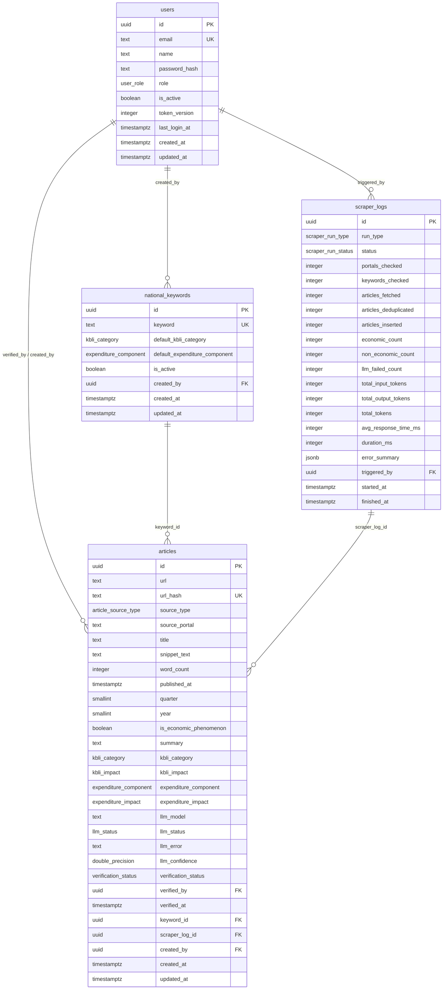

# Spesifikasi Skema Database PostgreSQL & Drizzle ORM — SIPENA KTT

**Versi Dokumen:** 1.0.0 (Single Source of Truth)  
**Database Engine:** PostgreSQL 16 (Lokal VPS Ubuntu 24.04)  
**ORM & Migrasi:** Drizzle ORM (`drizzle-orm/pg-core`) + Drizzle Kit (`drizzle-kit generate` & `drizzle-kit migrate`)  
**Konvensi Skema:** `UUID` primary key, semua stempel waktu bertipe `TIMESTAMPTZ`, string panjang bebas bertipe `TEXT`, indeks eksplisit pada seluruh *Foreign Key* dan kolom filter utama, serta `CHECK` constraint integritas PDRB.

---

## 1. Diagram Hubungan Entitas (ERD)



---

## 2. Enums TypeScript & Katalog Label Domain (`shared/enums/pdrb.ts`)

Seluruh enum domain PDRB didefinisikan pada berkas isomorfik `shared/enums/pdrb.ts` agar dipakai bersama oleh **Drizzle Schema (PostgreSQL)**, **Zod Validation (API & LLM)**, **Komponen Nuxt UI v3**, dan **Generator Ekspor ExcelJS**.

```ts
// shared/enums/pdrb.ts

export enum KbliCategoryEnum {
  A = 'A',
  B = 'B',
  C = 'C',
  D = 'D',
  E = 'E',
  F = 'F',
  G = 'G',
  H = 'H',
  I = 'I',
  J = 'J',
  K = 'K',
  L = 'L',
  M = 'M',
  N = 'N',
  O = 'O',
  P = 'P',
  Q = 'Q',
  R = 'R',
  S = 'S',
  T = 'T',
  U = 'U',
}

export interface KbliCategoryMeta {
  code: KbliCategoryEnum;
  name: string;
  fullLabel: string;
  pdrb17GroupCode: string;
  pdrb17GroupLabel: string;
}

export const KBLI_CATEGORY_META: Record<KbliCategoryEnum, KbliCategoryMeta> = {
  [KbliCategoryEnum.A]: {
    code: KbliCategoryEnum.A,
    name: 'Pertanian, Kehutanan, dan Perikanan',
    fullLabel: 'A - Pertanian, Kehutanan, dan Perikanan',
    pdrb17GroupCode: 'A',
    pdrb17GroupLabel: 'Pertanian, Kehutanan, dan Perikanan',
  },
  [KbliCategoryEnum.B]: {
    code: KbliCategoryEnum.B,
    name: 'Pertambangan dan Penggalian',
    fullLabel: 'B - Pertambangan dan Penggalian',
    pdrb17GroupCode: 'B',
    pdrb17GroupLabel: 'Pertambangan dan Penggalian',
  },
  [KbliCategoryEnum.C]: {
    code: KbliCategoryEnum.C,
    name: 'Industri Pengolahan',
    fullLabel: 'C - Industri Pengolahan',
    pdrb17GroupCode: 'C',
    pdrb17GroupLabel: 'Industri Pengolahan',
  },
  [KbliCategoryEnum.D]: {
    code: KbliCategoryEnum.D,
    name: 'Pengadaan Listrik dan Gas',
    fullLabel: 'D - Pengadaan Listrik dan Gas',
    pdrb17GroupCode: 'D',
    pdrb17GroupLabel: 'Pengadaan Listrik dan Gas',
  },
  [KbliCategoryEnum.E]: {
    code: KbliCategoryEnum.E,
    name: 'Pengadaan Air, Pengelolaan Sampah, Limbah dan Daur Ulang',
    fullLabel: 'E - Pengadaan Air, Pengelolaan Sampah, Limbah dan Daur Ulang',
    pdrb17GroupCode: 'E',
    pdrb17GroupLabel: 'Pengadaan Air, Pengelolaan Sampah, Limbah dan Daur Ulang',
  },
  [KbliCategoryEnum.F]: {
    code: KbliCategoryEnum.F,
    name: 'Konstruksi',
    fullLabel: 'F - Konstruksi',
    pdrb17GroupCode: 'F',
    pdrb17GroupLabel: 'Konstruksi',
  },
  [KbliCategoryEnum.G]: {
    code: KbliCategoryEnum.G,
    name: 'Perdagangan Besar dan Eceran; Reparasi Mobil dan Sepeda Motor',
    fullLabel: 'G - Perdagangan Besar dan Eceran; Reparasi Mobil dan Sepeda Motor',
    pdrb17GroupCode: 'G',
    pdrb17GroupLabel: 'Perdagangan Besar dan Eceran; Reparasi Mobil dan Sepeda Motor',
  },
  [KbliCategoryEnum.H]: {
    code: KbliCategoryEnum.H,
    name: 'Pengangkutan dan Pergudangan',
    fullLabel: 'H - Pengangkutan dan Pergudangan',
    pdrb17GroupCode: 'H',
    pdrb17GroupLabel: 'Transportasi dan Pergudangan',
  },
  [KbliCategoryEnum.I]: {
    code: KbliCategoryEnum.I,
    name: 'Penyediaan Akomodasi dan Makan Minum',
    fullLabel: 'I - Penyediaan Akomodasi dan Makan Minum',
    pdrb17GroupCode: 'I',
    pdrb17GroupLabel: 'Penyediaan Akomodasi dan Makan Minum',
  },
  [KbliCategoryEnum.J]: {
    code: KbliCategoryEnum.J,
    name: 'Informasi dan Komunikasi',
    fullLabel: 'J - Informasi dan Komunikasi',
    pdrb17GroupCode: 'J',
    pdrb17GroupLabel: 'Informasi dan Komunikasi',
  },
  [KbliCategoryEnum.K]: {
    code: KbliCategoryEnum.K,
    name: 'Aktivitas Keuangan dan Asuransi',
    fullLabel: 'K - Aktivitas Keuangan dan Asuransi',
    pdrb17GroupCode: 'K',
    pdrb17GroupLabel: 'Jasa Keuangan dan Asuransi',
  },
  [KbliCategoryEnum.L]: {
    code: KbliCategoryEnum.L,
    name: 'Real Estat',
    fullLabel: 'L - Real Estat',
    pdrb17GroupCode: 'L',
    pdrb17GroupLabel: 'Real Estat',
  },
  [KbliCategoryEnum.M]: {
    code: KbliCategoryEnum.M,
    name: 'Aktivitas Profesional, Ilmiah dan Teknis',
    fullLabel: 'M - Aktivitas Profesional, Ilmiah dan Teknis',
    pdrb17GroupCode: 'M,N',
    pdrb17GroupLabel: 'Jasa Perusahaan',
  },
  [KbliCategoryEnum.N]: {
    code: KbliCategoryEnum.N,
    name: 'Aktivitas Penyewaan dan Sewa Guna Usaha Tanpa Hak Opsi, Ketenagakerjaan, Agen Perjalanan dan Penunjang Usaha Lainnya',
    fullLabel: 'N - Aktivitas Penyewaan dan Sewa Guna Usaha Tanpa Hak Opsi, Ketenagakerjaan, Agen Perjalanan dan Penunjang Usaha Lainnya',
    pdrb17GroupCode: 'M,N',
    pdrb17GroupLabel: 'Jasa Perusahaan',
  },
  [KbliCategoryEnum.O]: {
    code: KbliCategoryEnum.O,
    name: 'Administrasi Pemerintahan, Pertahanan dan Jaminan Sosial Wajib',
    fullLabel: 'O - Administrasi Pemerintahan, Pertahanan dan Jaminan Sosial Wajib',
    pdrb17GroupCode: 'O',
    pdrb17GroupLabel: 'Administrasi Pemerintahan, Pertahanan dan Jaminan Sosial Wajib',
  },
  [KbliCategoryEnum.P]: {
    code: KbliCategoryEnum.P,
    name: 'Pendidikan',
    fullLabel: 'P - Pendidikan',
    pdrb17GroupCode: 'P',
    pdrb17GroupLabel: 'Jasa Pendidikan',
  },
  [KbliCategoryEnum.Q]: {
    code: KbliCategoryEnum.Q,
    name: 'Aktivitas Kesehatan Manusia dan Aktivitas Sosial',
    fullLabel: 'Q - Aktivitas Kesehatan Manusia dan Aktivitas Sosial',
    pdrb17GroupCode: 'Q',
    pdrb17GroupLabel: 'Jasa Kesehatan dan Kegiatan Sosial',
  },
  [KbliCategoryEnum.R]: {
    code: KbliCategoryEnum.R,
    name: 'Kesenian, Hiburan dan Rekreasi',
    fullLabel: 'R - Kesenian, Hiburan dan Rekreasi',
    pdrb17GroupCode: 'R,S,T,U',
    pdrb17GroupLabel: 'Jasa Lainnya',
  },
  [KbliCategoryEnum.S]: {
    code: KbliCategoryEnum.S,
    name: 'Aktivitas Jasa Lainnya',
    fullLabel: 'S - Aktivitas Jasa Lainnya',
    pdrb17GroupCode: 'R,S,T,U',
    pdrb17GroupLabel: 'Jasa Lainnya',
  },
  [KbliCategoryEnum.T]: {
    code: KbliCategoryEnum.T,
    name: 'Aktivitas Rumah Tangga Sebagai Pemberi Kerja; Aktivitas yang Menghasilkan Barang dan Jasa oleh Rumah Tangga yang Digunakan untuk Memenuhi Kebutuhan Sendiri',
    fullLabel: 'T - Aktivitas Rumah Tangga Sebagai Pemberi Kerja dan Produksi Sendiri',
    pdrb17GroupCode: 'R,S,T,U',
    pdrb17GroupLabel: 'Jasa Lainnya',
  },
  [KbliCategoryEnum.U]: {
    code: KbliCategoryEnum.U,
    name: 'Aktivitas Badan Internasional dan Badan Ekstra Internasional Lainnya',
    fullLabel: 'U - Aktivitas Badan Internasional dan Badan Ekstra Internasional Lainnya',
    pdrb17GroupCode: 'R,S,T,U',
    pdrb17GroupLabel: 'Jasa Lainnya',
  },
};

export enum KbliImpactEnum {
  INCREASE_NTB = 'INCREASE_NTB',
  DECREASE_NTB = 'DECREASE_NTB',
  INCREASE_PRICE = 'INCREASE_PRICE',
  DECREASE_PRICE = 'DECREASE_PRICE',
}

export const KBLI_IMPACT_LABELS: Record<KbliImpactEnum, string> = {
  [KbliImpactEnum.INCREASE_NTB]: 'Meningkatkan NTB',
  [KbliImpactEnum.DECREASE_NTB]: 'Menurunkan NTB',
  [KbliImpactEnum.INCREASE_PRICE]: 'Meningkatkan Harga',
  [KbliImpactEnum.DECREASE_PRICE]: 'Menurunkan Harga',
};

export enum ExpenditureComponentEnum {
  PK_RT = 'PK_RT',
  PK_LNPRT = 'PK_LNPRT',
  PK_P = 'PK_P',
  PMTB = 'PMTB',
  INVENTORY_CHANGE = 'INVENTORY_CHANGE',
  NET_EXPORT = 'NET_EXPORT',
}

export const EXPENDITURE_COMPONENT_LABELS: Record<
  ExpenditureComponentEnum,
  { short: string; official: string }
> = {
  [ExpenditureComponentEnum.PK_RT]: {
    short: 'PK-RT',
    official: 'PK-RT (Pengeluaran Konsumsi Rumah Tangga)',
  },
  [ExpenditureComponentEnum.PK_LNPRT]: {
    short: 'PK-LNPRT',
    official: 'PK-LNPRT (Pengeluaran Konsumsi LNPRT)',
  },
  [ExpenditureComponentEnum.PK_P]: {
    short: 'PK-P',
    official: 'PK-P (Pengeluaran Konsumsi Pemerintah)',
  },
  [ExpenditureComponentEnum.PMTB]: {
    short: 'PMTB',
    official: 'PMTB (Pembentukan Modal Tetap Bruto)',
  },
  [ExpenditureComponentEnum.INVENTORY_CHANGE]: {
    short: 'Perubahan Inventori',
    official: 'Perubahan Inventori',
  },
  [ExpenditureComponentEnum.NET_EXPORT]: {
    short: 'Ekspor Bersih Antar Daerah/Luar Negeri',
    official: 'Ekspor Bersih Antar Daerah/Luar Negeri',
  },
};

export enum ExpenditureImpactEnum {
  INCREASE_REAL = 'INCREASE_REAL',
  DECREASE_REAL = 'DECREASE_REAL',
  INCREASE_DEFLATOR = 'INCREASE_DEFLATOR',
  DECREASE_DEFLATOR = 'DECREASE_DEFLATOR',
}

export const EXPENDITURE_IMPACT_LABELS: Record<ExpenditureImpactEnum, string> = {
  [ExpenditureImpactEnum.INCREASE_REAL]: 'Meningkatkan Pengeluaran Riil',
  [ExpenditureImpactEnum.DECREASE_REAL]: 'Menurunkan Pengeluaran Riil',
  [ExpenditureImpactEnum.INCREASE_DEFLATOR]: 'Meningkatkan Indeks Harga/Deflator',
  [ExpenditureImpactEnum.DECREASE_DEFLATOR]: 'Menurunkan Indeks Harga/Deflator',
};

export enum VerificationStatusEnum {
  PENDING = 'PENDING',
  VERIFIED = 'VERIFIED',
  IGNORED = 'IGNORED',
}

export const VERIFICATION_STATUS_LABELS: Record<VerificationStatusEnum, string> = {
  [VerificationStatusEnum.PENDING]: 'Menunggu Review',
  [VerificationStatusEnum.VERIFIED]: 'Terverifikasi',
  [VerificationStatusEnum.IGNORED]: 'Diabaikan',
};

export enum ArticleSourceTypeEnum {
  REGIONAL = 'REGIONAL',
  NATIONAL = 'NATIONAL',
  MANUAL = 'MANUAL',
}

export enum LlmStatusEnum {
  SUCCESS = 'SUCCESS',
  FAILED = 'FAILED',
  SKIPPED_MANUAL = 'SKIPPED_MANUAL',
}

export enum ScraperRunTypeEnum {
  SCHEDULED = 'SCHEDULED',
  MANUAL = 'MANUAL',
  RETRY_LLM = 'RETRY_LLM',
}

export enum ScraperRunStatusEnum {
  RUNNING = 'RUNNING',
  SUCCESS = 'SUCCESS',
  PARTIAL = 'PARTIAL',
  FAILED = 'FAILED',
}

export enum UserRoleEnum {
  ADMIN = 'ADMIN',
  OPERATOR = 'OPERATOR',
}
```

---

## 3. Kode Skema Drizzle ORM Lengkap (`server/db/schema.ts`)

Skema PostgreSQL di bawah dirancang agar 100% *type-safe* di Drizzle ORM, bebas *floating-point rounding* pada counter, menggunakan *composite & partial indexes*, serta mencegah *orphan record* maupun penghapusan riwayat arsip saat keyword/log dihapus.

```ts
// server/db/schema.ts
import { relations, sql } from 'drizzle-orm';
import {
  boolean,
  check,
  doublePrecision,
  index,
  integer,
  jsonb,
  pgEnum,
  pgTable,
  smallint,
  text,
  timestamp,
  uniqueIndex,
  uuid,
} from 'drizzle-orm/pg-core';
import {
  ArticleSourceTypeEnum,
  ExpenditureComponentEnum,
  ExpenditureImpactEnum,
  KbliCategoryEnum,
  KbliImpactEnum,
  LlmStatusEnum,
  ScraperRunStatusEnum,
  ScraperRunTypeEnum,
  UserRoleEnum,
  VerificationStatusEnum,
} from '../../shared/enums/pdrb';

// Helper untuk mengubah TypeScript String Enum menjadi tuple pgEnum Drizzle
function enumValues<T extends Record<string, string>>(e: T): [T[keyof T], ...T[keyof T][]] {
  return Object.values(e) as [T[keyof T], ...T[keyof T][]];
}

// ============================================================================
// 1. PostgreSQL Native Enums (pgEnum)
// ============================================================================

export const kbliCategoryPgEnum = pgEnum('kbli_category', enumValues(KbliCategoryEnum));
export const kbliImpactPgEnum = pgEnum('kbli_impact', enumValues(KbliImpactEnum));
export const expenditureComponentPgEnum = pgEnum(
  'expenditure_component',
  enumValues(ExpenditureComponentEnum),
);
export const expenditureImpactPgEnum = pgEnum(
  'expenditure_impact',
  enumValues(ExpenditureImpactEnum),
);
export const verificationStatusPgEnum = pgEnum(
  'verification_status',
  enumValues(VerificationStatusEnum),
);
export const articleSourceTypePgEnum = pgEnum(
  'article_source_type',
  enumValues(ArticleSourceTypeEnum),
);
export const llmStatusPgEnum = pgEnum('llm_status', enumValues(LlmStatusEnum));
export const scraperRunTypePgEnum = pgEnum(
  'scraper_run_type',
  enumValues(ScraperRunTypeEnum),
);
export const scraperRunStatusPgEnum = pgEnum(
  'scraper_run_status',
  enumValues(ScraperRunStatusEnum),
);
export const userRolePgEnum = pgEnum('user_role', enumValues(UserRoleEnum));

// ============================================================================
// 2. Tabel `users` — Autentikasi & Otorisasi Staf Admin Nerwilis
// ============================================================================

export const users = pgTable(
  'users',
  {
    id: uuid('id').defaultRandom().primaryKey(),
    email: text('email').notNull(),
    name: text('name').notNull(),
    passwordHash: text('password_hash').notNull(),
    role: userRolePgEnum('role').notNull().default(UserRoleEnum.OPERATOR),
    isActive: boolean('is_active').notNull().default(true),
    tokenVersion: integer('token_version').notNull().default(1),
    lastLoginAt: timestamp('last_login_at', { withTimezone: true, mode: 'date' }),
    createdAt: timestamp('created_at', { withTimezone: true, mode: 'date' })
      .notNull()
      .defaultNow(),
    updatedAt: timestamp('updated_at', { withTimezone: true, mode: 'date' })
      .notNull()
      .defaultNow()
      .$onUpdate(() => new Date()),
  },
  (t) => [
    uniqueIndex('users_email_uidx').on(sql`lower(${t.email})`),
    index('users_is_active_idx').on(t.isActive),
  ],
);

// ============================================================================
// 3. Tabel `national_keywords` — Master Keyword Portal Berita Nasional
// ============================================================================

export const nationalKeywords = pgTable(
  'national_keywords',
  {
    id: uuid('id').defaultRandom().primaryKey(),
    keyword: text('keyword').notNull(),
    defaultKbliCategory: kbliCategoryPgEnum('default_kbli_category'),
    defaultExpenditureComponent: expenditureComponentPgEnum('default_expenditure_component'),
    description: text('description'),
    isActive: boolean('is_active').notNull().default(true),
    createdBy: uuid('created_by').references(() => users.id, { onDelete: 'set null' }),
    createdAt: timestamp('created_at', { withTimezone: true, mode: 'date' })
      .notNull()
      .defaultNow(),
    updatedAt: timestamp('updated_at', { withTimezone: true, mode: 'date' })
      .notNull()
      .defaultNow()
      .$onUpdate(() => new Date()),
  },
  (t) => [
    uniqueIndex('national_keywords_keyword_uidx').on(sql`lower(${t.keyword})`),
    index('national_keywords_active_idx').on(t.isActive),
    index('national_keywords_created_by_idx').on(t.createdBy),
  ],
);

// ============================================================================
// 4. Tabel `scraper_logs` — Riwayat Bot Subuh, Trigger Manual & Token LLM
// ============================================================================

export interface ScraperPortalErrorEntry {
  source: string;
  stage: 'HARVEST' | 'FETCH' | 'EXTRACT' | 'LLM' | 'SYSTEM';
  message: string;
  url?: string;
}

export const scraperLogs = pgTable(
  'scraper_logs',
  {
    id: uuid('id').defaultRandom().primaryKey(),
    runType: scraperRunTypePgEnum('run_type').notNull(),
    status: scraperRunStatusPgEnum('status').notNull().default(ScraperRunStatusEnum.RUNNING),
    portalsChecked: integer('portals_checked').notNull().default(0),
    keywordsChecked: integer('keywords_checked').notNull().default(0),
    articlesFetched: integer('articles_fetched').notNull().default(0),
    articlesDeduplicated: integer('articles_deduplicated').notNull().default(0),
    articlesInserted: integer('articles_inserted').notNull().default(0),
    economicCount: integer('economic_count').notNull().default(0),
    nonEconomicCount: integer('non_economic_count').notNull().default(0),
    llmFailedCount: integer('llm_failed_count').notNull().default(0),
    totalInputTokens: integer('total_input_tokens').notNull().default(0),
    totalOutputTokens: integer('total_output_tokens').notNull().default(0),
    totalTokens: integer('total_tokens').notNull().default(0),
    avgResponseTimeMs: integer('avg_response_time_ms').notNull().default(0),
    durationMs: integer('duration_ms'),
    errorSummary: jsonb('error_summary').$type<ScraperPortalErrorEntry[]>().notNull().default([]),
    triggeredBy: uuid('triggered_by').references(() => users.id, { onDelete: 'set null' }),
    startedAt: timestamp('started_at', { withTimezone: true, mode: 'date' })
      .notNull()
      .defaultNow(),
    finishedAt: timestamp('finished_at', { withTimezone: true, mode: 'date' }),
  },
  (t) => [
    index('scraper_logs_started_at_idx').on(t.startedAt.desc()),
    index('scraper_logs_status_idx').on(t.status),
    index('scraper_logs_triggered_by_idx').on(t.triggeredBy),
    check('scraper_logs_counters_nonneg_chk', sql`
      ${t.portalsChecked} >= 0 AND
      ${t.keywordsChecked} >= 0 AND
      ${t.articlesFetched} >= 0 AND
      ${t.articlesDeduplicated} >= 0 AND
      ${t.articlesInserted} >= 0 AND
      ${t.totalTokens} >= 0
    `),
  ],
);

// ============================================================================
// 5. Tabel `articles` — Bank Data Berita & Klasifikasi Fenomena PDRB
// ============================================================================

export const articles = pgTable(
  'articles',
  {
    id: uuid('id').defaultRandom().primaryKey(),
    url: text('url').notNull(),
    urlHash: text('url_hash').notNull(), // SHA-256 hex (64 char) dari URL ternormalisasi
    sourceType: articleSourceTypePgEnum('source_type').notNull(),
    sourcePortal: text('source_portal').notNull(), // mis. 'kaltara.tribunnews.com', 'korankaltara.com', 'Manual'
    title: text('title').notNull(),
    snippetText: text('snippet_text').notNull(), // Teks bersih 150-250 kata (~1.000-1.500 karakter)
    wordCount: integer('word_count').notNull().default(0),
    publishedAt: timestamp('published_at', { withTimezone: true, mode: 'date' }).notNull(),
    quarter: smallint('quarter').notNull(), // 1 | 2 | 3 | 4
    year: smallint('year').notNull(),       // mis. 2026

    // Hasil Klasifikasi AI / Kurasi Admin
    isEconomicPhenomenon: boolean('is_economic_phenomenon'), // null bila LLM gagal & belum ditinjau manual
    summary: text('summary'), // Ringkasan berita 2-3 kalimat baku bahasa Indonesia
    kbliCategory: kbliCategoryPgEnum('kbli_category'),
    kbliImpact: kbliImpactPgEnum('kbli_impact'),
    expenditureComponent: expenditureComponentPgEnum('expenditure_component'),
    expenditureImpact: expenditureImpactPgEnum('expenditure_impact'),

    // Telemetry & Fallback LLM Worker
    llmModel: text('llm_model'), // mis. 'gemini-3.8-flash' | 'gemini-3.5-flash-lite'
    llmStatus: llmStatusPgEnum('llm_status').notNull().default(LlmStatusEnum.SUCCESS),
    llmError: text('llm_error'),
    llmConfidence: doublePrecision('llm_confidence'), // 0.0 - 1.0 opsional untuk prioritas review

    // Alur Kurasi Nerwilis
    verificationStatus: verificationStatusPgEnum('verification_status')
      .notNull()
      .default(VerificationStatusEnum.PENDING),
    verifiedBy: uuid('verified_by').references(() => users.id, { onDelete: 'set null' }),
    verifiedAt: timestamp('verified_at', { withTimezone: true, mode: 'date' }),

    // Jejak Sumber & Audit
    keywordId: uuid('keyword_id').references(() => nationalKeywords.id, { onDelete: 'set null' }),
    scraperLogId: uuid('scraper_log_id').references(() => scraperLogs.id, { onDelete: 'set null' }),
    createdBy: uuid('created_by').references(() => users.id, { onDelete: 'set null' }),
    createdAt: timestamp('created_at', { withTimezone: true, mode: 'date' })
      .notNull()
      .defaultNow(),
    updatedAt: timestamp('updated_at', { withTimezone: true, mode: 'date' })
      .notNull()
      .defaultNow()
      .$onUpdate(() => new Date()),
  },
  (t) => [
    // Keunikan & Deduplikasi URL O(1)
    uniqueIndex('articles_url_hash_uidx').on(t.urlHash),

    // Query Feed Publik (`/`) & Agregasi KPI Triwulanan (covering filter tercepat)
    index('articles_public_period_idx').on(
      t.verificationStatus,
      t.isEconomicPhenomenon,
      t.year,
      t.quarter,
      t.publishedAt.desc(),
    ),

    // Query Antrean Review Harian (`/admin/review`: Tab Pending/Verified/Ignored)
    index('articles_review_queue_idx').on(t.verificationStatus, t.publishedAt.desc()),

    // Filter Analitik KBLI & Komponen Pengeluaran per Periode
    index('articles_kbli_period_idx').on(t.kbliCategory, t.year, t.quarter),
    index('articles_exp_period_idx').on(t.expenditureComponent, t.year, t.quarter),
    index('articles_source_portal_idx').on(t.sourcePortal, t.publishedAt.desc()),

    // Indeks Wajib seluruh Foreign Key (PostgreSQL tidak mengindeks FK secara otomatis)
    index('articles_keyword_id_idx').on(t.keywordId),
    index('articles_scraper_log_id_idx').on(t.scraperLogId),
    index('articles_verified_by_idx').on(t.verifiedBy),
    index('articles_created_by_idx').on(t.createdBy),

    // Partial Index khusus antrean retry artikel yang gagal diproses Gemini Free Tier
    index('articles_llm_retry_partial_idx')
      .on(t.createdAt)
      .where(sql`${t.llmStatus} = 'FAILED'`),

    // Integritas Domain & Kebenaran Data
    check('articles_quarter_range_chk', sql`${t.quarter} BETWEEN 1 AND 4`),
    check('articles_year_range_chk', sql`${t.year} BETWEEN 2000 AND 2100`),
    check('articles_word_count_chk', sql`${t.wordCount} >= 0`),
    check(
      'articles_verified_completeness_chk',
      sql`${t.verificationStatus} <> 'VERIFIED' OR (
        ${t.isEconomicPhenomenon} = true AND
        ${t.summary} IS NOT NULL AND
        ${t.kbliCategory} IS NOT NULL AND
        ${t.kbliImpact} IS NOT NULL AND
        ${t.expenditureComponent} IS NOT NULL AND
        ${t.expenditureImpact} IS NOT NULL
      )`,
    ),
  ],
);

// ============================================================================
// 6. Drizzle Relations & Inferred Types
// ============================================================================

export const usersRelations = relations(users, ({ many }) => ({
  createdKeywords: many(nationalKeywords),
  triggeredRuns: many(scraperLogs),
  verifiedArticles: many(articles, { relationName: 'verifiedByUser' }),
  createdArticles: many(articles, { relationName: 'createdByUser' }),
}));

export const nationalKeywordsRelations = relations(nationalKeywords, ({ one, many }) => ({
  creator: one(users, {
    fields: [nationalKeywords.createdBy],
    references: [users.id],
  }),
  articles: many(articles),
}));

export const scraperLogsRelations = relations(scraperLogs, ({ one, many }) => ({
  triggeredByUser: one(users, {
    fields: [scraperLogs.triggeredBy],
    references: [users.id],
  }),
  articles: many(articles),
}));

export const articlesRelations = relations(articles, ({ one }) => ({
  keyword: one(nationalKeywords, {
    fields: [articles.keywordId],
    references: [nationalKeywords.id],
  }),
  scraperLog: one(scraperLogs, {
    fields: [articles.scraperLogId],
    references: [scraperLogs.id],
  }),
  verifier: one(users, {
    fields: [articles.verifiedBy],
    references: [users.id],
    relationName: 'verifiedByUser',
  }),
  creator: one(users, {
    fields: [articles.createdBy],
    references: [users.id],
    relationName: 'createdByUser',
  }),
}));

export type UserRecord = typeof users.$inferSelect;
export type NewUserRecord = typeof users.$inferInsert;
export type NationalKeywordRecord = typeof nationalKeywords.$inferSelect;
export type NewNationalKeywordRecord = typeof nationalKeywords.$inferInsert;
export type ScraperLogRecord = typeof scraperLogs.$inferSelect;
export type NewScraperLogRecord = typeof scraperLogs.$inferInsert;
export type ArticleRecord = typeof articles.$inferSelect;
export type NewArticleRecord = typeof articles.$inferInsert;
```

---

## 4. Konfigurasi Koneksi PostgreSQL & Drizzle Kit

### 4.1 Inisialisasi Pool (`server/db/index.ts`)
```ts
// server/db/index.ts
import { drizzle } from 'drizzle-orm/node-postgres';
import { Pool } from 'pg';
import * as schema from './schema';

const pool = new Pool({
  connectionString: process.env.DATABASE_URL,
  max: 10,
  idleTimeoutMillis: 30_000,
  connectionTimeoutMillis: 5_000,
});

export const db = drizzle(pool, { schema });
export { pool };
```

### 4.2 Konfigurasi Drizzle Kit (`drizzle.config.ts`)
```ts
// drizzle.config.ts
import { defineConfig } from 'drizzle-kit';

export default defineConfig({
  schema: './server/db/schema.ts',
  out: './server/db/migrations',
  dialect: 'postgresql',
  dbCredentials: {
    url: process.env.DATABASE_URL!,
  },
  verbose: true,
  strict: true,
});
```

---

## 5. Penyetelan Pencarian Teks Penuh & Migrasi Tambahan

Untuk mendukung pencarian kata kunci multi-parameter yang cepat pada `/admin/articles` (`ILIKE '%sawit%'` pada `title` dan `summary`), tambahkan *custom SQL migration* berikut setelah `npx drizzle-kit generate` pertama:

```sql
CREATE EXTENSION IF NOT EXISTS pg_trgm;

CREATE INDEX IF NOT EXISTS articles_title_trgm_idx
  ON articles USING gin (title gin_trgm_ops);

CREATE INDEX IF NOT EXISTS articles_summary_trgm_idx
  ON articles USING gin (summary gin_trgm_ops);
```

### Catatan Keamanan Migrasi Produksi
1. Selalu gunakan `npx drizzle-kit generate` saat pengembangan lokal lalu eksekusi `npx drizzle-kit migrate` saat deployment di VPS Ubuntu 24.04. Dilarang menggunakan `drizzle-kit push` di lingkungan produksi.
2. Untuk penambahan nilai `pgEnum` di masa mendatang (jika ada revisi kode KBLI), selalu lakukan melalui skrip migrasi `ALTER TYPE ... ADD VALUE IF NOT EXISTS ...`.
3. Karena kolom `articles.verified_by`, `articles.keyword_id`, `articles.scraper_log_id`, dan `articles.created_by` menggunakan `ON DELETE SET NULL`, penghapusan akun staf non-aktif, kata kunci lama, atau log *scraper* tua **tidak akan pernah menghapus** arsip berita ekonomi PDRB yang sudah terkumpul.

