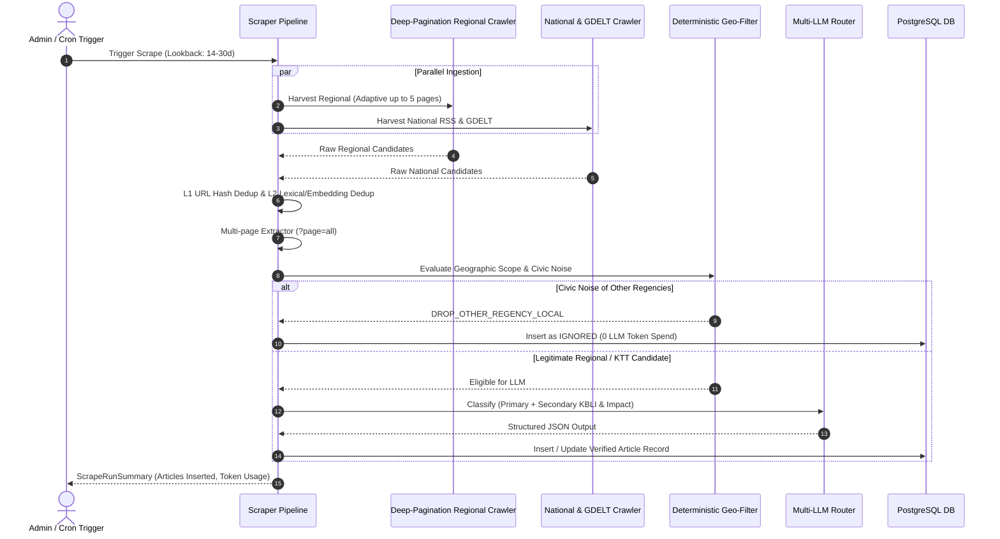

# Enhanced Scraper Engine & Multi-Sector AI Classification Architecture

**File:** `docs/superpowers/specs/2026-11-13-enhanced-scraper-engine-design.md`  
**Date:** 2026-11-13  
**Status:** Approved for Implementation Planning  
**Scope:** Regional & Government Source Expansion, Adaptive Deep-Pagination Crawler, Resilient Content Extractor (`?page=all`), Database Multi-Sector Schema, Cross-Sector LLM Classifier, and Anti-False-Positive Regional Filters.

---

## 1. Executive Summary & Problem Statement

### 1.1 Background & Context
SIPENA KTT (Sistem Informasi Pemantauan Ekonomi & Berita Neraca Wilayah Kabupaten Tana Tidung) tracks regional economic phenomena to support economic analysis and regional accounting (PDRB) for BPS Kabupaten Tana Tidung, North Kalimantan.

Currently, the production database contains approximately 82 articles, predominantly concentrated in Quarter IV 2026. This limited historical and overall volume stems from three structural constraints in the existing engine:
1. **Shallow Single-Page Crawling**: The regional scraper only retrieves page 1 (up to 15 items) and looks back only 7 days. Portals that publish news on Tana Tidung 1–2 times per week quickly bury older articles onto page 2, 3, or deeper archives.
2. **Limited Source Portals**: The crawler relies on only 4 media outlets, omitting high-authority government and regional sectoral sources (such as the Tana Tidung Regency Government official portal, Antara News Kaltara, and local business media).
3. **Truncated Articles & Single-Sector Taxonomies**: Multi-page portal layouts (like Tribun Network) truncate article bodies, causing the LLM to miss crucial financial/production figures. Furthermore, current database columns only permit a single KBLI category and single expenditure component, failing to reflect inter-industry spillovers (such as mill construction driving both Construction F and Manufacturing C).

### 1.2 Core Objectives
1. **Triple Regional Sourcing**: Integrate official government portals (`tanatidungkab.go.id`, `kaltaraprov.go.id`) and authoritative regional media (`kaltara.antaranews.com`, `focusborneo.com`, `niaga.asia`, `prokaltara.jawapos.com`).
2. **Adaptive Deep-Pagination**: Crawl pages 1 through $N$ with date-driven early exit (stopping immediately when articles exceed the lookback cutoff, capped at a maximum of 5 pages).
3. **Resilient Multi-Page Extraction**: Auto-append `?page=all` for multi-page portals to preserve complete numerical data (millions/billions Rp, tons, hectares).
4. **Multi-Sector Taxonomy (Primary + Secondary)**: Expand database schema and LLM structured prompt to capture both primary and secondary KBLI/Expenditure categories and directional impacts.
5. **Anti-False-Positive Macro Filters**: Expand national keywords while enforcing deterministic pre-filters to reject purely local civic noise from neighboring municipalities (Tarakan, Nunukan) with zero wasted LLM tokens.

---

## 2. Source Portals Configuration & SSRF Security

### 2.1 Newly Registered Regional & Government Sources
The configuration array in `server/services/scraper/portals.ts` is expanded to include 6 additional sources:

| ID | Label | Source Domain | Target URLs | Selectors / Fallback Feeds |
| :--- | :--- | :--- | :--- | :--- |
| `pemkab-tana-tidung` | Pemkab Tana Tidung | `tanatidungkab.go.id` | `https://tanatidungkab.go.id/berita` | `article`, `.news-item`, `.card-body` |
| `pemprov-kaltara` | Pemprov Kalimantan Utara | `kaltaraprov.go.id` | `https://kaltaraprov.go.id/berita`, `https://disbun.kaltaraprov.go.id` | `article`, `.post`, `.entry-content` |
| `antara-kaltara` | Antara News Kaltara | `kaltara.antaranews.com` | `https://kaltara.antaranews.com/kaltara/tana-tidung`, `https://kaltara.antaranews.com/ekonomi` | `article.simple-post`, `.latest-news li` |
| `fokus-borneo` | Fokus Borneo | `focusborneo.com` | `https://focusborneo.com/category/tana-tidung/` | `article`, `.post-item`, `feed/` |
| `niaga-asia` | Niaga.Asia | `niaga.asia` | `https://www.niaga.asia/tag/tana-tidung/`, `https://www.niaga.asia/category/ekonomi-bisnis/` | `article`, `.td_module_wrap` |
| `pro-kaltara` | Pro Kaltara (Jawa Pos) | `prokaltara.jawapos.com` | `https://prokaltara.jawapos.com/tana-tidung` | `.ui-r-fg`, `.latest__item`, `article` |

### 2.2 SSRF Whitelist & Host Validation
All new hostnames are added to `server/utils/ssrf.ts` validation lists. Private CIDR blocks (`10.0.0.0/8`, `172.16.0.0/12`, `192.168.0.0/16`, `127.0.0.0/8`, `169.254.0.0/16`, `::1`) remain strictly forbidden. Outbound requests enforce polite pacing (300–500 ms) and standard browser User-Agents.

---

## 3. Adaptive Deep-Pagination & Resilient Content Extraction

### 3.1 Adaptive Lookback Pagination Algorithm
Instead of scraping only the index page, `harvestRegionalPortals` iterates through pagination until one of three exit conditions is met:
1. **Date Cutoff Reached**: At least one article on the current page has a publication date older than `cutoffDate = getWitaLookbackCutoff(now, lookbackDays)`.
2. **Ceiling Cap Reached**: Maximum page depth limit reached (default `MAX_PAGES_PER_PORTAL = 5`).
3. **No New Items Found**: The page returns zero valid article links or duplicates previous links.

```
Page URL Resolution Pattern:
- WordPress / clean path: ${baseUrl.replace(/\/$/, '')}/page/${pageNum}/
- Query param: ${baseUrl}?page=${pageNum} (or &paged=${pageNum} if ? already exists)
```

### 3.2 Multi-Page Content Density (`?page=all`)
Multi-page articles in Indonesian news networks frequently truncate the core story:
- For `kaltara.tribunnews.com`, append `?page=all` to article URLs before fetching.
- In `server/services/scraper/extractor.ts`, `extractArticleContent` parses all `<p>` tags inside `article`, `.side-article.txt-article`, `.read__content`, or `.entry-content`.
- Retain numeric entity sentences (`Rp`, `persen`, `ton`, `hektare`, `miliar`, `triliun`) to ensure economic magnitude is intact for the LLM.

---

## 4. Multi-Sector Database Schema & AI Classifier

### 4.1 PostgreSQL Schema Migration (`server/db/schema.ts`)
Add 4 nullable columns to the `articles` table:

```typescript
// Sektor & Dampak Sekunder (Inter-industry Linkage)
secondaryKbliCategory: varchar('secondary_kbli_category', { length: 2 }),
secondaryKbliImpact: varchar('secondary_kbli_impact', { length: 30 }),
secondaryExpenditureComponent: varchar('secondary_expenditure_component', { length: 30 }),
secondaryExpenditureImpact: varchar('secondary_expenditure_impact', { length: 30 }),
```

### 4.2 Zod Schema & LLM Classification Output
Extend `shared/schemas/llm-output.schema.ts` and `shared/schemas/article.schema.ts`:
- `secondary_kbli_category`: Optional/nullable enum (KbliCategoryEnum A–V).
- `secondary_kbli_impact`: Optional/nullable enum (KbliImpactEnum).
- `secondary_expenditure_component`: Optional/nullable enum (ExpenditureComponentEnum).
- `secondary_expenditure_impact`: Optional/nullable enum (ExpenditureImpactEnum).

### 4.3 Prompt Refinement in `server/services/llm/classifier.ts`
Instruct the LLM:
- **Primary Sector**: The direct and dominant account according to BPS PDRB methodology.
- **Secondary Sector**: Populated ONLY when there is clear, measurable cross-sector economic linkage (e.g. factory construction affecting F and C; drought affecting A and H). Otherwise, return `null`.

### 4.4 Public & Admin Query Integration
- `server/api/public/articles.get.ts` and `server/services/articles/query.ts`:
  When filtering by KBLI category (e.g., `C`), query:
  `WHERE (kbli_category IN (...) OR secondary_kbli_category IN (...))`
  Similarly for expenditure components.
- In UI (`LinimasaArticleCard.vue` and `AdminArticleItem`):
  Display secondary badge with subtle styling: `Sekunder: C - Industri`.

---

## 5. National Keywords & Anti-False-Positive Filtering

### 5.1 Expanded Keyword Targets
Add 6 targeted keywords to `INITIAL_KEYWORDS` in `server/db/seed.ts` and active crawlers:
1. `"harga TBS kaltara"` $\rightarrow$ KBLI A, NET_EXPORT
2. `"ekspor batubara kalimantan utara"` $\rightarrow$ KBLI B, NET_EXPORT
3. `"DBH sawit kaltara"` $\rightarrow$ KBLI P, PK_P
4. `"subsidi ongkos angkut kaltara"` $\rightarrow$ KBLI H, PK_P
5. `"logistik pelabuhan kaltara tarakan"` $\rightarrow$ KBLI H, NET_EXPORT
6. `"inflasi kalimantan utara"` $\rightarrow$ KBLI G, PK_RT

### 5.2 Deterministic False-Positive Prevention (`geo-filter.ts`)
If an article mentions neighboring cities (`Tarakan`, `Nunukan`, `Bulungan`, `Malinau`) without explicit KTT keywords:
- Check for civic local noise indicators (`razia`, `satpol pp`, `pdam tarakan`, `pemkot tarakan`, `futsal`, `curanmor`, `kebakaran rumah`).
- If matched $\rightarrow$ immediately mark `DROP_OTHER_REGENCY_LOCAL` (stored with `verification_status = 'IGNORED'`, zero LLM tokens burned).
- If containing macro commodity terms $\rightarrow$ passed to LLM under `KALTARA_PROVINCIAL` or `NATIONAL_MACRO_IMPACT`.

---

## 6. Architecture & Data Flow



---

## 7. Verification & Testing Plan

1. **Unit Testing (Vitest)**:
   - Deep-pagination URL formatting and early exit condition test.
   - `?page=all` extraction test for multi-page articles.
   - Secondary KBLI and Expenditure schema parsing and validation.
   - Geo-filter noise detection test for Tarakan civic news vs Kaltara macro news.
2. **Typecheck & Integration**:
   - `npm run typecheck` (`nuxt typecheck`) with 0 errors.
   - Run full vitest suite (target: 100% pass across all test suites).
3. **Database Migration Verification**:
   - Run Drizzle migration to add secondary columns to PostgreSQL.
   - Verify existing records retain integrity (`NULL` for secondary columns).
4. **Live Deployment & Verification**:
   - Push commit to `main`, pull to Biznet VPS, build Nitro, reload PM2.
   - Test scraping execution via Admin Scraper panel or API endpoint.
