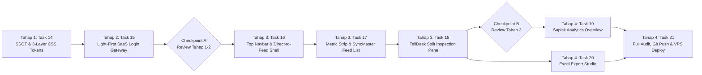

# SIPENA-KTT — Master Implementation Plan (`tasks/plan.md`)

**Goal**: Build, verify, and evolve **SIPENA-KTT** (*Sistem Informasi Fenomena Ekonomi dan Neraca Tana Tidung*) for BPS Kabupaten Tana Tidung (`6504`) into a modern, high-trust Light-First SaaS Curation & Analytics Platform inspired by **Sapick Astro**, **SyncMaster Astro**, and **TellDesk Astro**.

---

## Completed Foundation & Core Engineering Phases (Phases 1–6)

### Phase 1: Foundation & Contracts (`Completed`)
- **[x] Task 1**: Project Scaffolding & Design Token System (`package.json`, `tsconfig.json`, `src/app/globals.css`, `src/app/layout.tsx`)
- **[x] Task 2**: BPS Taxonomy Constants & Domain Contracts (`src/lib/constants/taxonomy.ts`, `src/lib/constants/taxonomy.test.ts`)
- **[x] Task 3**: Drizzle ORM PostgreSQL Schema & Seed Script (`src/db/schema.ts`, `src/db/index.ts`, `src/db/seed.ts`)

### Phase 2: Core Logic — Scraping, Classification & Auth (`Completed`)
- **[x] Task 4**: Rule-Based Economic Classification & Deduplication Engine (`src/lib/classifier/economic-classifier.ts`, `src/lib/classifier/deduplicator.ts`)
- **[x] Task 5**: RSS/HTML Regional News Ingestion Service (`src/lib/scraper/rss-ingestor.ts`)
- **[x] Task 6**: Authentication & RBAC Session Utility (`src/lib/auth/session.ts`, `src/app/api/auth/login/route.ts`, `src/app/api/auth/logout/route.ts`)

### Phase 3: API Routes & Excel Export Engine (`Completed`)
- **[x] Task 7**: Phenomena CRUD, Verification, Manual Entry & Ingestion API Routes (`src/app/api/phenomena/**`, `src/app/api/ingest/route.ts`)
- **[x] Task 8**: Multi-Sheet `.xlsx` Export Builder & API Endpoint (`src/lib/export/excel-builder.ts`, `src/app/api/export/excel/route.ts`)

### Phase 4: Initial Frontend Workstation UI (`Completed`)
- **[x] Task 9**: Authentication Login Page & Protected Layout Shell
- **[x] Task 10**: Executive Overview & 17-KBLI Distribution Visualization
- **[x] Task 11**: Curation Data Table, Filter Bar & Keyboard-Accessible Review Modal
- **[x] Task 12**: Excel Export Center & Live Ingestion Drawer

### Phase 5 & 6: Verification, Hardening & Initial Rollout (`Completed`)
- **[x] Task 13**: End-to-End Verification, Security Headers, Production Build & VPS Deployment (`https://sipena-ktt.caplinlab.my.id`)

---

## UI/UX Total Redesign Plan — Sapick & SyncMaster Modern Light-First SaaS (Phases 7–10)

### Architectural Summary & Reference Alignment
Following user review of the live deployment and comparison against 5 Themefisher Astro references (**Sapick**, **SyncMaster**, **TellDesk**, **BlazeX**, **AutomatePro**), the UI/UX is being systematically redesigned across **4 Stages (Tahap 1–4)** with zero changes to backend API contracts or database schema:

1. **Style & Palette (`Gaya Sapick & SyncMaster`)**:
   - **Light-First Default**: Pure White (`#FFFFFF`) elevated cards over a Soft Alabaster (`#F7F8FA`) canvas with diffused ambient shadows (`--shadow-card`) and `1px` `#EEF0F4` hairlines.
   - **Obsidian Ink (`#0F172A`) + Forest Emerald (`#059669` / `#047857`)**: Obsidian Ink primary SaaS CTA buttons paired with Forest Emerald brand accents, focus rings, and verified status indicators.
   - **Typography**: `Plus Jakarta Sans` across all headings, prose, labels, and `tabular-nums` KPI numbers (`metric` scale). `JetBrains Mono` restricted to `<kbd>` shortcut hints and short technical codes.
2. **Corner Geometry (`Rounded Modern`)**:
   - `rounded-lg` (`8px`) for pastel status chips and taxonomy pills; `rounded-xl` (`12px`) for buttons, inputs, selects, and top nav tabs; `rounded-2xl` (`16px-20px`) for cards, split panes, and login container.
3. **Navigation & Layout (`Top Navbar + Direct-to-Curation Split-View`)**:
   - Remove the dark left sidebar completely; use a single `64px` sticky horizontal Top Navigation Bar.
   - Default landing view after login is **`Meja Kurasi`** (`activeTab = "feed"`) featuring an interactive 4-stat metric strip at the top and a **Master-Detail Split-View Workbench** (SyncMaster clean list on the left + TellDesk sticky inline inspection/verification pane on the right on `xl+`, with native `<dialog>` sheet fallback on `< xl`).

---

### Tahap 1 (Phase 7): Design System Single Source of Truth & 3-Layer Token Foundation

#### Task 14: Synchronize SSOT Docs & Implement 3-Layer Light-First CSS Tokens
- **Description**: Align `PRODUCT.md`, `DESIGN.md`, `.impeccable/design.json`, and `docs/design-system.md` (`v3.0.0`) with the Sapick & SyncMaster Light-First SaaS specification, then update `src/app/globals.css`, `src/app/layout.tsx`, `src/components/theme-provider.tsx`, `src/components/brand-mark.tsx`, and `src/lib/constants/taxonomy.ts` so the entire app boots in Light Mode (`#F7F8FA` canvas, `#FFFFFF` cards, `#0F172A` Obsidian CTA, `#059669` Emerald brand) with calm pastel KBLI chips instead of dark `-700` blocks.
- **Acceptance Criteria**:
  - `PRODUCT.md`, `DESIGN.md`, `.impeccable/design.json`, and `docs/design-system.md` all specify the identical token values, `Plus Jakarta Sans` `tabular-nums` metric scale, `rounded-xl`/`rounded-2xl` geometry, and Top Navbar + Split-View Curation architecture.
  - `src/app/globals.css` defines the 3-layer CSS custom properties (`Primitive -> Semantic -> Component`), `.card-surface`, `.btn-obsidian`, `.btn-emerald`, `.input-modern`, and `.hairline-row` utilities.
  - `src/components/theme-provider.tsx` and `src/app/layout.tsx` enforce Light-First rendering (`defaultTheme="light"`, eliminating accidental dark-mode startup).
  - `src/lib/constants/taxonomy.ts` uses soft pastel/neutral surface tints with WCAG AA dark text for KBLI badges (`badgeClass`) while preserving all 17 KBLI codes and 8 Expenditure codes so existing unit tests pass.
- **Verification**:
  - `npm run typecheck` and `npm test` pass (`22/22` tests green).
- **Dependencies**: None.
- **Files likely touched**:
  - `PRODUCT.md`
  - `DESIGN.md`
  - `.impeccable/design.json`
  - `docs/design-system.md`
  - `src/app/globals.css`
  - `src/app/layout.tsx`
  - `src/components/theme-provider.tsx`
  - `src/components/brand-mark.tsx`
  - `src/lib/constants/taxonomy.ts`
- **Estimated Scope**: S (2–3 hours)

---

### Tahap 2 (Phase 8): Modern Light-First SaaS Authentication Gateway (`/login`)

#### Task 15: Redesign `/login` Page & Form in Sapick / AutomatePro Light-First SaaS Style
- **Description**: Replace the split dark-capable login screen with a clean, Light-First SaaS authentication gateway (`src/app/(auth)/login/page.tsx` and `src/app/(auth)/login/login-form.tsx`). Use a soft alabaster canvas (`#F7F8FA`) with a subtle radial emerald-mint ambient wash, a centered `max-w-[440px]` pure white `rounded-2xl` card with `--shadow-floating`, `rounded-xl` inputs (`h-11`), post-interaction field validation, password visibility toggle, and a full-width Obsidian Ink (`#0F172A`) submit button.
- **Acceptance Criteria**:
  - `/login` always renders in crisp Light Mode (`#F7F8FA` background, `#FFFFFF` card) with zero dark-mode flash and zero premature red validation banners before the user interacts with an input.
  - Primary submit button uses Obsidian Ink (`#0F172A`, hover `#1E293B`) with `rounded-xl` (`12px`) corners and clear loading spinner state.
  - Form inputs use `rounded-xl` (`12px`), `1px solid #CBD5E1` resting border, and `#059669` focus ring (`rgba(5, 150, 105, 0.16)`).
  - Responsive across `1440x900` desktop and `375x812` mobile with zero horizontal overflow.
- **Verification**:
  - `npm run typecheck` and `npm run build` succeed.
  - Headless Chrome screenshot & contrast inspection on `/login` at `1440px` and `375px`.
- **Dependencies**: Task 14.
- **Files likely touched**:
  - `src/app/(auth)/login/page.tsx`
  - `src/app/(auth)/login/login-form.tsx`
- **Estimated Scope**: S (2 hours)

> **Checkpoint A (After Tahap 1 & Tahap 2)**: Verify CSS token foundation and `/login` visual quality before transforming the main workspace shell.

---

### Tahap 3 (Phase 9): Top Navbar Shell & Direct-to-Curation Split-View Workbench (`Meja Kurasi`)

#### Task 16: Replace Left Sidebar with `64px` Top Navbar & Direct-to-Curation Workspace Shell
- **Description**: Refactor `src/components/dashboard/command-header.tsx` and `src/components/sipena-workspace.tsx` to eliminate the left sidebar completely and replace it with a sticky `64px` horizontal Top Navigation Bar (`bg-white/90 backdrop-blur-md border-b border-[#EEF0F4]`). Set the default landing tab after login to `"feed"` (`Meja Kurasi`). Include the 3 horizontal tabs (`Meja Kurasi` with pending counter pill, `Ringkasan Analitik`, `Pusat Ekspor Excel`), inline Period Selector (`rounded-xl`), `+ Tarik Berita` Obsidian CTA button, Operator profile badge with logout action, and a clean `<dialog>` mobile menu. Also update the ingestion & manual-entry slide-over drawers in `sipena-workspace.tsx` to match the `rounded-2xl` Light-First style.
- **Acceptance Criteria**:
  - Zero left sidebar exists on any viewport; full width (`max-w-[1600px] mx-auto`) is dedicated to the active workspace view.
  - Initial `activeTab` defaults to `"feed"` (`Meja Kurasi`) unless overridden by URL query param.
  - Active tab displays a soft mint pill (`#ECFDF5`), deep emerald text (`#047857`), and a `2px` `#059669` bottom indicator.
  - Keyboard shortcuts (`Ctrl+K` / `/` for search, `N` for manual phenomenon entry) continue to work seamlessly.
- **Verification**:
  - `npm run typecheck` passes; keyboard and tab navigation verified in browser.
- **Dependencies**: Task 14, Task 15.
- **Files likely touched**:
  - `src/components/dashboard/command-header.tsx`
  - `src/components/sipena-workspace.tsx`
- **Estimated Scope**: M (3–4 hours)

#### Task 17: Build Interactive 4-Stat Metric Strip & SyncMaster-Style Phenomenon Feed List
- **Description**: Upgrade `src/components/phenomena/curation-table.tsx` and `src/components/phenomena/status-badge.tsx` to implement:
  1. **Interactive 4-Stat Metric Strip** at the top of `Meja Kurasi` (`Total Fenomena`, `Menunggu Verifikasi`, `Disetujui ke PDRB`, `Cakupan Sektor KBLI`) in `rounded-2xl` white cards with `Plus Jakarta Sans` `tabular-nums` numbers (`26px` bold) that filter the list on click.
  2. **Unified `rounded-2xl` Filter & Search Bar** with `rounded-xl` search input, status pill tabs, KBLI dropdown, and Expenditure dropdown.
  3. **SyncMaster-Style Clean Phenomenon List**: Replace rigid grid borders with `1px` `#EEF0F4` hairlines, generous `16px 20px` row padding, `#ECFDF5` active row highlight with a `3px` `#059669` left accent bar, calm KBLI/Expenditure pills (`rounded-lg`), and soft pastel status chips (`Disetujui`, `Pending`, `Perlu Revisi`, `Ditolak`). Preserve multi-row batch selection and bulk verification actions.
- **Acceptance Criteria**:
  - Clicking any of the 4 top metric cards filters the phenomenon list immediately.
  - Status badges use soft pastel fills (`#ECFDF5`, `#FFFBEB`, `#EFF6FF`, `#FFF1F2`), `1px` tinted borders, and WCAG AA dark text (`> 6:1` contrast) with `rounded-lg` (`8px`) corners.
  - `J` and `K` keys move the active selection up/down the list and automatically update the right-hand Split Inspection Pane.
- **Verification**:
  - `npm run typecheck` passes; filter interactions and `J`/`K` navigation verified.
- **Dependencies**: Task 16.
- **Files likely touched**:
  - `src/components/phenomena/status-badge.tsx`
  - `src/components/phenomena/curation-table.tsx`
- **Estimated Scope**: M (3–4 hours)

#### Task 18: Build TellDesk-Style Inline Split Inspection & Verification Pane (`SplitInspectionPane`)
- **Description**: Refactor `src/components/phenomena/review-modal.tsx` so it functions both as an **Inline Sticky Split Inspection & Verification Pane** on the right side of `Meja Kurasi` on desktop (`xl+`, `480px-540px` wide) and as a responsive native `<dialog>` slide-over sheet on smaller screens (`< xl`). Include TellDesk-inspired underline tabs (`Ringkasan & Klasifikasi`, `Teks Berita Asli`, `Riwayat Audit`), clickable source URL, inline KBLI 17-sector selector (`rounded-xl`), Expenditure selector (`rounded-xl`), reviewer notes textarea, and instant verification actions (`[A] Setujui` in Forest Emerald `#059669`, `Perlu Revisi`, `[R] Tolak`).
- **Acceptance Criteria**:
  - Selecting any row in `Meja Kurasi` on desktop (`1440px`) displays its full details and classification controls immediately in the right-hand pane without requiring a blocking modal popup.
  - Underline tabs switch cleanly between Classification form, Full scraped article body (`cleanText`), and Verification metadata.
  - Keyboard shortcuts `A` (Approve) and `R` (Reject) trigger verification when focus is not inside a text input.
  - On viewports `< 1280px` (`< xl`), clicking a row opens the responsive `<dialog>` sheet with full focus management and `Esc` support.
- **Verification**:
  - `npm run typecheck` passes; inline verification (`PATCH /api/phenomena/[id]/verify`) updates both the split pane and the left list optimistically/reactively.
- **Dependencies**: Task 16, Task 17.
- **Files likely touched**:
  - `src/components/phenomena/review-modal.tsx`
  - `src/components/phenomena/curation-table.tsx`
  - `src/components/sipena-workspace.tsx`
- **Estimated Scope**: M (3–4 hours)

> **Checkpoint B (After Tahap 3)**: Verify the complete `Meja Kurasi` Split-View workflow before redesigning the secondary tabs (`Ringkasan Analitik` & `Pusat Ekspor Excel`).

---

### Tahap 4 (Phase 10): Sapick-Style Analytics Overview, Export Studio & Production VPS Rollout

#### Task 19: Redesign `Ringkasan Analitik` in Sapick & BlazeX Style
- **Description**: Update `src/components/dashboard/overview-panel.tsx`, `src/components/dashboard/metrics-cards.tsx`, and `src/components/dashboard/sector-distribution.tsx` to use Sapick/BlazeX `rounded-2xl` pure white cards (`--shadow-card`), `Plus Jakarta Sans` `tabular-nums` KPI displays, smooth emerald/slate horizontal proportion bars for the 17 KBLI sectors (clicking any sector drills directly into `Meja Kurasi` filtered by that KBLI code), Expenditure component cards, Regional Media Source breakdown, and Recent Verified Phenomena cards.
- **Acceptance Criteria**:
  - All analytics cards use `rounded-2xl` (`16px`), `1px solid #EEF0F4`, and `--shadow-card` with zero dark boxy borders or monospace KPI numbers.
  - Clicking a KBLI sector row in `SectorDistribution` switches to `Meja Kurasi` (`activeTab = "feed"`) filtered to that sector.
- **Verification**:
  - `npm run typecheck` passes; drill-down interaction verified.
- **Dependencies**: Task 16.
- **Files likely touched**:
  - `src/components/dashboard/overview-panel.tsx`
  - `src/components/dashboard/metrics-cards.tsx`
  - `src/components/dashboard/sector-distribution.tsx`
- **Estimated Scope**: S–M (2–3 hours)

#### Task 20: Redesign `Pusat Ekspor Excel` in Clean SaaS Card Style
- **Description**: Update `src/components/export/export-center.tsx` to match the Sapick & SyncMaster Light-First design system: a `rounded-2xl` white export configurator card with `rounded-xl` period selector, verified-only toggle switch, and an Obsidian Ink (`#0F172A`) `Unduh Kertas Kerja (.xlsx)` primary button, accompanied by 3 clean worksheet summary cards (`Ringkasan_Eksekutif`, `Matriks_KBLI_PDRB`, `Daftar_Fenomena_Audit`) and a hairline-divided preview table.
- **Acceptance Criteria**:
  - `.xlsx` download triggers cleanly and matches the active period and verified-only filter.
  - Preview table uses `#EEF0F4` hairlines and pastel status badges.
- **Verification**:
  - `npm run typecheck` and `npm test` pass.
- **Dependencies**: Task 16.
- **Files likely touched**:
  - `src/components/export/export-center.tsx`
- **Estimated Scope**: S (1.5–2 hours)

#### Task 21: End-to-End Quality Gate, Visual Browser Audit & Production VPS Redeploy
- **Description**: Run the complete engineering and design verification suite (`npm run typecheck`, `npm test`, `npm run build`, `npx impeccable detect --json`), perform a live headless Chrome visual & accessibility inspection across `/login` and `/` (`Meja Kurasi`, `Ringkasan Analitik`, `Pusat Ekspor Excel`) at `1440x900` and `375x812`, run the Antislop Delivery Gate (`R-01` through `R-11`), push the commits to GitHub (`origin/main`), and redeploy the Docker production stack on the VPS (`https://sipena-ktt.caplinlab.my.id`).
- **Acceptance Criteria**:
  - `npm run typecheck`, `npm test`, and `npm run build` pass with 0 errors.
  - Headless Chrome screenshots confirm Light-First rendering, zero horizontal overflow, WCAG AA contrast, and working split-view curation.
  - `https://sipena-ktt.caplinlab.my.id` serves the new UI/UX live with `GET /api/health` returning `200 OK`.
- **Verification**:
  - Live HTTP & headless Chrome verification against `https://sipena-ktt.caplinlab.my.id`.
- **Dependencies**: Task 14–20.
- **Files likely touched**:
  - `tasks/todo.md`
- **Estimated Scope**: S (1.5 hours)
